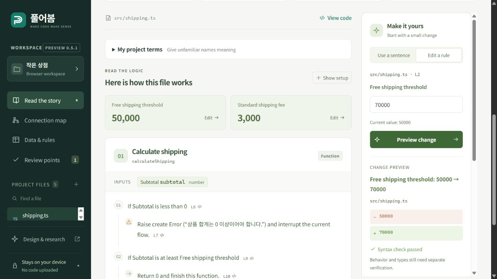

<div align="center">

# Pureobom · 풀어봄

### Explore the system. Edit the design. Review the implementation.

Explore an existing codebase, edit the behavior you want, and connect that design to changes in code and tests.

**System design workspace · 0.7 development:** [Product requirements](docs/SYSTEM_WORKSPACE_PLAN.md) · [Verified scope and remaining work](docs/SYSTEM_WORKSPACE_STATUS.md) · [Start here](docs/SYSTEM_WORKSPACE_START.md). The published 0.6.0 extension and hosted browser demo are the earlier single-file preview; they do not include this workspace.

**Desktop VS Code extension · Local structure analysis · Optional Codex implementation · MIT**

Structure exploration works without a model. Implementation requires an explicitly selected Codex connection and project checks. The current system design interface is in Korean; the earlier reading interface supports Korean and English.

[한국어](README.ko.md) · [Watch 30 seconds](https://him55710-sudo.github.io/pureobom/demo.html) · [Try the demo](https://him55710-sudo.github.io/pureobom/?demo=shipping&lang=en) · [Install](#try-it) · [Examples](examples/README.md) · [Contribute](CONTRIBUTING.md)

[](https://github.com/him55710-sudo/pureobom/actions/workflows/ci.yml)

</div>

## Start with the system design workspace

Build the development VSIX from this branch and run **풀어봄: 시스템 설계 워크스페이스 열기** (`pureobom.openWorkspace`) in a local TypeScript/React Git project. Select a structure or create a business feature linked to several files. Read its code evidence, then describe the desired behavior, invariants and acceptance criteria.

**Explore → edit the design → save and implement → inspect changes and checks → apply → refresh the structure.**

`설계만 저장` saves the specification. `저장하고 구현` starts Codex in a separate Git worktree. Review the actual diff and command results before applying; undo restores the code while preserving the design goal. A changed source baseline or failed check prevents applying an old result. A worktree separates changes; it is not an operating-system security boundary.

The first target is an existing feature spanning a React interface, server actions/API and a shared policy. [The external Next.js team-permission case](validation/next-saas-starter/README.md) records both successful checks and failed attempts. [The status table](docs/SYSTEM_WORKSPACE_STATUS.md) identifies unverified parts, including native Webview interaction and interrupted-agent reconnection. This is a development preview, not a completed release.

[Install and first task](docs/SYSTEM_WORKSPACE_START.md) · [Execution settings](docs/EXECUTION_SETTINGS.md) · [Review and apply](docs/IMPLEMENTATION_REVIEW.md) · [Recovery](docs/AGENT_IMPLEMENTATION.md)

## Earlier single-file preview — published 0.6.0

The video, hosted demo and single-file capabilities below describe the earlier release. They do not demonstrate the system design workflow above.

[](https://him55710-sudo.github.io/pureobom/demo.html)

**[Watch the 30-second walkthrough](https://him55710-sudo.github.io/pureobom/demo.html)** — source → explanation → diff → comparison → apply → undo. Real browser screenshots, edited for reading time; English and Korean captions. [MP4](https://him55710-sudo.github.io/pureobom/media/pureobom-30s.mp4).

Pureobom turns JavaScript and TypeScript into source-linked stories, editable rules and a dependency map. It is for people who know what their product should do but struggle to inspect the code an AI generates.

Change a free-shipping threshold from **50,000 to 70,000**. Compare several order amounts. Inspect the exact code diff, apply the change in VS Code, and undo it with the editor's normal undo command.

| Order subtotal | Before | After | What changed? |
| --- | --- | --- | --- |
| 49,999 | 3,000 | 3,000 | Same |
| 50,000 | 0 | 3,000 | Shipping now charged |
| 60,000 | 0 | 3,000 | Shipping now charged |
| 70,000 | 0 | 0 | Still free |

These are computed example outputs, not an application-wide correctness claim.

## Try it

**New in 0.6 — understand editor errors:** in VS Code, review reported errors and warnings beside the explanation, read plain-language help for common TypeScript errors and jump to the exact code. Try changing a typed shipping fee to an unsupported value, then undo. [Walkthrough and limits](docs/EDITOR_REPORTS.md). Empty reports are not a passed type check; the browser demo does not provide VS Code diagnostics.

**VS Code — the primary experience**

1. Download `pureobom-0.6.0.vsix` from [Releases](https://github.com/him55710-sudo/pureobom/releases) (or build it below).
2. In VS Code, open Extensions → `…` → **Install from VSIX…**.
3. Run **Pureobom: Try an example** in the Command Palette. In a Korean VS Code installation, the command is **풀어봄: 예제로 시작하기**.
4. Edit the threshold, compare inputs, inspect the native diff, then apply. `Ctrl+Z` / `Cmd+Z` undoes; `Ctrl+S` / `Cmd+S` saves.

**Browser — no account or API key**

[Open the live demo](https://him55710-sudo.github.io/pureobom/?demo=shipping&lang=en). One click prepares a rule change; compare the outcomes before applying it. Your own files stay on your device.

With Node.js 24 and pnpm 11.25.0 installed, from this source folder:

```sh
pnpm install --frozen-lockfile
pnpm dev
```

Open `http://127.0.0.1:5173/?demo=shipping&lang=en` (use `lang=ko` for Korean). Demo mode does not read or overwrite your saved browser workspace. Remove `demo=shipping` to use the persistent local workspace.

The prebuilt `pureobom-0.6.0-demo.zip` only needs Node.js 24: unzip, run `node scripts/serve.mjs`, and open the printed address. On Windows, double-click `START.cmd`.

Source: [him55710-sudo/pureobom](https://github.com/him55710-sudo/pureobom). Marketplace publication is not yet available; use the VSIX distribution.

**After your first change:** open **Install & feedback** in the demo or **Help & feedback** in VS Code. Try one task with your own code, then optionally review and copy a feedback summary. Nothing is submitted automatically. [Feedback guide](docs/FEEDBACK.md) · [Planned user study](docs/USER_STUDY.md).

## Earlier preview capabilities

- **Read:** Korean/English explanations anchored to the exact source lines, including unsaved VS Code edits.
- **Follow cleanup:** read try, catch and finally as separate paths, including pending returns through cleanup. [Corrected in 0.5.2](docs/CONTROL_FLOW.md).
- **Read a React interface:** expand JSX elements, text, conditions and event props. Select a phrase and change the real source with a checked diff. [Try it](https://him55710-sudo.github.io/pureobom/?demo=interface&lang=en) · [Scope and limits](docs/INTERFACE.md).
- **Use your words:** give unfamiliar variables, functions and inputs your own Korean/English names. Terms stay tied to their declarations and work in sentence edits. [How project terms work](docs/TERMINOLOGY.md).
- **Explore:** function inputs, conditions, returns, a rule table, static relative-import graph and limited review hints.
- **Change:** numbers, strings, booleans and comparison operators through the same checked patch path.
- **Compare:** up to 12 editable input cases, suggested numeric boundaries, before/after outputs and an explicit unavailable state.
- **Explain to someone else:** a local Markdown report containing the displayed comparison. Nothing is automatically published.
- **Stay in control:** native diff, explicit apply, normal save/undo, stale-document checks and local workers.

## Published 0.6 preview boundaries

The published **0.6 single-file preview** has the boundaries below. The development system workspace has a separate [support and evidence table](docs/SYSTEM_WORKSPACE_STATUS.md).

| Area | Current boundary |
| --- | --- |
| Languages | JS/TS/JSX/TSX and related extensions; JSON overview. Other imported text is preserved, not explained. |
| Editing | Literals and comparison operators. No whole-feature generation or multi-file refactoring. |
| Understanding | Syntax-grounded descriptions, a built-in name glossary and your local project terms; no inferred business intent. |
| Comparison | Restricted AST interpretation of supported synchronous calculations. No arbitrary code execution, network, DOM, loops or external packages. |
| Verification | Syntax checks, limited static hints and VS Code-reported current-file diagnostics. No pre-apply type check, whole-project verification, application tests or security audit. |
| File limits | Up to 300 imported text files, 512 KB/file and 8 MB total. Exports contain imported files only. |
| Privacy | Analysis stays on-device. Normal hosted-demo asset requests still reach its host; browser workspaces persist in IndexedDB outside demo mode. |

An unavailable case is not a pass. A correct output for a few inputs does not prove a program correct. The import graph is a static relationship map, not complete runtime impact analysis. See [security and privacy](SECURITY.md).

## Build and verify

```sh
pnpm test
pnpm build
pnpm extension:build
pnpm extension:test      # downloads an isolated VS Code test host on first run
pnpm extension:package
pnpm release:package    # VSIX must already exist; creates source/demo ZIPs + SHA-256 sums
pnpm release:check      # verifies checksums and required contents
```

On Linux, run the integration step with `xvfb-run -a pnpm extension:test`. CI definitions cover Windows and Linux; local results are recorded separately in [validation](docs/RELEASE_VALIDATION.md).

The browser and extension share the analysis engine. The parser stays in a worker; UI code imports only lightweight view models. [Architecture](docs/ARCHITECTURE.md) · [Research](docs/RESEARCH.md) · [Product direction](docs/PRODUCT.md) · [Launch plan](docs/LAUNCH.md)

## Help make code understandable

Bring a small example where the explanation is confusing, improve a translation, or contribute a useful scenario. Start with [CONTRIBUTING.md](CONTRIBUTING.md). A reproducible counterexample is valuable even if you do not write code.

Licensed under [MIT](LICENSE). Bundled third-party licenses remain their own. No claims of measured user demand, retention or comprehension gains are made yet.
