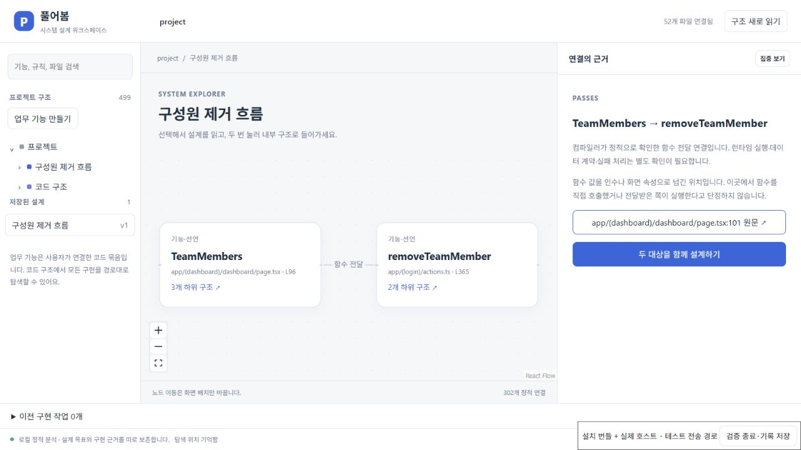

# 화면에서 서버 함수로 이어지는 전달 관계

`useActionState(removeTeamMember, {})`와 `<form action={customerPortalAction}>`는 함수 값을 넘기는 코드다. 이 위치에서 해당 함수를 직접 호출하는 것은 아니다. 이전 분석기는 호출·렌더링·모듈 가져오기만 추적해 이 관계를 놓쳤다.

TypeScript Compiler API로 인수와 JSX 속성에 전달된 함수 값의 심볼·호출 가능 타입을 확인하고 **함수 전달** 연결을 추가했다. 가져오기 별칭·재내보내기·경로 별칭을 실제 선언까지 따라가며, 동일한 이름의 다른 함수를 임의로 연결하지 않는다. 함수 팩토리가 반환한 함수를 변수로 보관한 경우에도 그 변수의 선언과 연결한다.

캔버스 연결선과 세부 근거, 설계의 저장 관측·현재 코드 비교에서 같은 관계와 소스 위치를 사용한다. 구현 범위 수집도 이 관계를 따라가므로 선택한 화면에 연결된 서버 함수와 그 의존성을 수집할 수 있다. 이전 관측에 없던 전달 관계는 새로 관측된 것으로 표시하며 사용자 목표를 덮어쓰지 않는다. 분석 리비전에는 분석기 버전을 포함해 같은 파일의 이전 분석과 새 결과를 구분한다.

## 같은 외부 앱에서 확인한 차이

고정 Next.js SaaS Starter 복사본의 같은 52개 분석 파일을 전후 대조했다. 이전 커밋 `a646611`에서는 아래 직접 관계가 모두 없었다. 새 분석은 세 전달 위치를 실제 원문 범위와 함께 찾았다.

| 화면의 선언 | 전달한 함수 | 근거 |
|---|---|---|
| `TeamMembers` | `removeTeamMember` | 대시보드 `page.tsx` 101행, `useActionState` 인수 |
| `InviteTeamMember` | `inviteTeamMember` | 같은 파일 196행, `useActionState` 인수 |
| `ManageSubscription` | `customerPortalAction` | 같은 파일 63행, form의 action 속성 |

이전 구현 범위에도 공용 코드의 다른 연결을 거쳐 서버 파일이 포함돼 있었다. 따라서 이 결과를 “이 앱에서는 이전에 서버 파일을 전혀 수집하지 못했다”는 주장으로 확대하지 않는다. 개선점은 화면과 서버 함수 사이의 직접 근거를 복원하고, 공용 코드의 우회 연결이 없는 경우에도 같은 전달을 추적하는 것이다. 원본 추적 파일 57개와 Git HEAD·index·상태는 바뀌지 않았다.

재현:

```powershell
node scripts/check-callback-structure.mjs '<준비한 Next baseline Git 폴더>'
```

선택적으로 세 번째 인수에 이전 분석 결과 JSON을 전달하면 같은 소스 해시인지 대조한다. 결과는 `test-results/callback-structure.json`에 저장한다. 모델이나 앱 코드를 실행하지 않는다.

## 검증과 한계

`tests/workspace-callbacks.test.ts`는 별칭·재내보내기, hook 인수와 JSX 속성, 호출과 전달의 구분, 실제 원문 범위, 서버와 정책까지의 구현 범위, 기존 관측 읽기·변경 감지·목표 보존을 검증한다. 일반 데이터와 함수 호출의 반환값을 함수 선언으로 오인하지 않으며, 조건부 함수 선택이나 구현을 찾지 못한 함수 매개변수는 미확인으로 남긴다.

전달받은 라이브러리가 실제로 함수를 실행하는지, 어떤 요청·오류 처리를 거치는지까지 증명하지 않는다. 객체·배열 안의 간접 함수 값, bind나 팩토리 호출의 반환값, 동적 라우트 URL 연결은 완전하게 해석하지 않는다. 외부 모듈·타입이 없으면 일부 함수 값도 식별하지 못한다. 구현 범위는 기존의 정적 연결 탐색이며, 공용 코드를 통해 다른 소비자까지 넓어질 수 있어 검토가 필요하다.

## 2026-10-20 실행 기록

- 같은 외부 앱의 [변경 전](evidence/system-workspace/2026-10-20/callback-before.json)과 [변경 후](evidence/system-workspace/2026-10-20/callback-structure.json): 분석 파일 52개의 해시 일치, 직접 전달 3개 확인, 원본 추적 파일 57개와 Git 보존.
- [설치 화면 검증](evidence/system-workspace/2026-10-20/callback-installed-ui.json): 요청 15개 성공, 클라이언트 오류 0개, 모델 작업 0개. 두 선언을 업무 기능으로 묶고 목표·완료 기준을 저장한 뒤 전달 연결선에서 정확한 `removeTeamMember` 원문 범위로 이동했다. 저장 관측에도 `passes`가 남았으며 원본 보존을 확인했다.
- 설치한 VSIX SHA-256: `a9c9fdcfa17c73a801a8c607aa2bf23acee9ae7798906f4b9483070966fcbff2`. 수정하지 않은 설치 JS/CSS와 실제 Production 확장 호스트를 사용했다. 브라우저 전송 경로를 연결한 검증이며 네이티브 VS Code Webview의 포인터 전달은 검증하지 않았다.
- 전체 회귀 첫 실행은 [219개 통과·29개 실패](evidence/system-workspace/2026-10-20/callback-regressions-initial-failed.json)였다. 확장 빌드와 겹친 실행에서 초기화·종료·시간 초과 실패가 발생했다. 빌드 종료 후 테스트 코드와 제한 시간을 바꾸지 않고 `pnpm exec vitest run --maxWorkers=2`로 재실행해 [248개 모두 통과](evidence/system-workspace/2026-10-20/callback-regressions-two-workers.json)했다. 첫 실패의 원인이 전부 자원 경합이었다고 단정하지 않는다.

업무 기능 생성 직후 선택이 이전 코드 대상으로 돌아가는 화면도 관측했다. 이후 해당 기능을 다시 선택해 내부 탐색·저장·원문 이동을 완료했으며, 생성 직후 선택 유지까지 검증했다고 주장하지 않는다.



설치 화면 재현은 준비한 외부 baseline 복사본을 사용한다. 이 모드는 구현·모델 호출을 허용하지 않는다.

```powershell
$env:PUREOBOM_DESIGN_UI='1'
$env:PUREOBOM_STRUCTURE_UI='1'
node scripts/test-installed-design-ui.mjs '<준비한 Next baseline Git 폴더>'
```

[실제 앱 변경 기록](INSTALLED_NEXT_FLOW.md) · [업무 기능](BUSINESS_FEATURES.md) · [설계와 코드 관측 비교](WORKSPACE_OBSERVATIONS.md)
