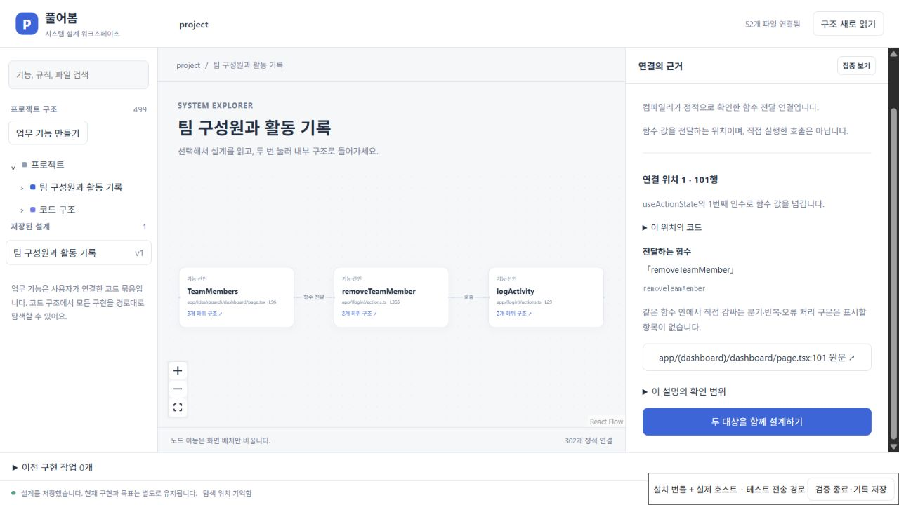
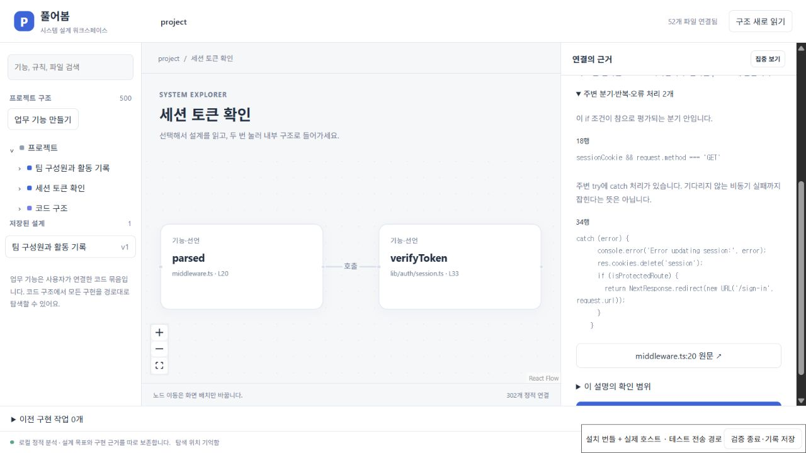

# 연결선에서 전달값과 주변 구문 읽기

구조 화면에서 연결선을 선택하면 각 발생 위치의 전달식, 받는 매개변수 이름, 직접 감싸는 분기·반복·오류 처리와 원문 이동을 볼 수 있다. TypeScript Compiler API의 실제 구문과 해결된 선언을 사용하며 모델을 호출하지 않는다. 같은 두 선언 사이의 호출이 여러 곳이면 위치마다 따로 설명하고 세 곳씩 더 펼친다.

- **호출**: 순서대로 전달하는 인수와 해결 가능한 매개변수 이름, 직접 `await`·반환·변수 보관 여부를 표시한다. 다른 파일의 매개변수는 해당 선언 파일에서 읽는다. 펼침 인수 뒤의 실제 위치는 단정하지 않는다.
- **함수 전달**: `useActionState` 같은 수신 함수나 JSX 속성 이름을 표시한다. 이 자리에서 전달한 함수를 실행했다는 뜻은 아니다.
- **화면 구성**: JSX 속성의 표현과 명시적 참 값, 펼친 속성을 표시한다. 덮어쓰기 이후 최종 값은 확정하지 않는다.
- **주변 구문**: if/else·조건식·단락 평가·반복문·switch·try/catch/finally를 읽는다. switch의 앞 case에서 내려오는 실행, do의 첫 실행, 기다리지 않는 비동기 실패를 구분한다. 가장 가까운 함수 경계를 넘어 외부 조건을 안쪽 콜백의 실행 조건으로 붙이지 않는다.

이 설명은 전체 제어 흐름이나 실행 결과의 증명이 아니다. 앞선 return/throw, 실제 입력값, 외부 오류 처리, 간접 호출·동적 연결은 별도 검토가 필요하다. 예를 들어 `removeTeamMember` 안에서 앞선 팀 소속 검사 후 `logActivity`를 호출해도, 앞선 종료 분기는 이 호출을 직접 감싸지 않으므로 여기서 호출 조건으로 복원하지 않는다. 원문으로 돌아가 확인할 수 있다.

## 저장한 관측과 비교

연결 횟수뿐 아니라 **모든 발생 위치의 전달식과 주변 구문**을 정규화해 SHA-256 지문으로 저장한다. 둘째 호출의 인수나 긴 조건의 생략된 뒷부분이 달라져도 차이를 감지한다. 주석과 줄 이동은 지문에 포함하지 않으며, 호출 대상의 구현만 바뀌었다고 호출식 자체도 달라진 것으로 처리하지 않는다. 실제 구현 변화는 기존 선언·규칙 비교가 담당한다. 코드 갱신은 사용자의 목표 문장을 덮어쓰지 않는다.

이전 버전의 관측에 지문이 없으면 상세 비교 근거가 부족하다고 표시한다. 횟수가 같은 이유만으로 내용도 같다고 판단하지 않는다. 중복 연결을 따로 넣은 수동 그래프도 하나의 지문으로 전체를 대표하지 않는다.

화면에는 위치별 인수·속성 최대 12개, 주변 구문 최대 8개, 코드 표현 앞 240자와 설명 앞 400자를 표시하고 생략을 알린다. 지문은 표시에서 생략한 원문도 포함한다. 저장 설계에는 상세 원문 전체를 복제하지 않고 기존 크기 제한 안에서 지문을 보존한다. 이전 전달값과 현재 전달값을 나란히 복원하는 기능이나 자연어 목표의 자동 충족 판정은 아니다.

## 재현과 검증 범위

```powershell
pnpm exec vitest run tests/workspace-connections.test.ts tests/workspace-observations.test.ts tests/workspace-callbacks.test.ts tests/system-workspace.test.ts --maxWorkers=2
node scripts/check-callback-structure.mjs '<준비한 Next baseline Git 폴더>'
```

단위 검사는 여러 호출의 분리·정확한 원문 범위·교차 파일 매개변수·콜백 경계·분기/반복/switch/catch/finally·펼침 인수·긴 표현 생략·둘째 호출 변경·기존 관측·목표 보존을 확인한다. 검사에서 다른 파일의 매개변수를 호출 파일의 오프셋으로 읽는 오류가 드러났고, 원래 선언 파일을 사용하도록 수정한 뒤 관련 28개가 통과했다.

외부 Next 앱에서는 같은 파일 52개를 분석해 연결 302개 모두의 위치별 근거와 지문을 확인했다. 분기·오류 처리 등을 포함한 호출 연결은 14개다. `TeamMembers`의 `useActionState(removeTeamMember, {})`, `InviteTeamMember`의 hook 전달, 결제 form의 action 전달을 구분하고, `removeTeamMember → logActivity`의 세 전달식과 await를 실제 코드와 대조했다. 원본 추적 파일 57개와 Git HEAD·index·상태를 보존했다. 앱이나 결제 서비스를 실행한 검증은 아니다.

검증 기록: [관련 28개](evidence/system-workspace/2026-10-20/connection-targeted.json), [전체 회귀 254개](evidence/system-workspace/2026-10-20/connection-regression.json), [확장 호스트 39개](evidence/system-workspace/2026-10-20/connection-host-integration.json), [외부 앱 상세 근거](evidence/system-workspace/2026-10-20/connection-structure.json). 이전 함수 전달 검증 기록과 source HEAD 및 파일 52개의 해시가 일치함도 별도 대조했다.

## 설치 화면 검증

새 VSIX의 수정하지 않은 JS/CSS와 실제 Production 확장 호스트를 연결했다. [최종 기록](evidence/system-workspace/2026-10-20/connection-installed-ui.json)은 요청 24개 모두 성공, 클라이언트 오류 0개, 모델 작업 0개다. 두 기능 묶음을 만들고 목표·완료 기준을 저장했으며, 함수 전달 지문이 저장 관측에 남는 것과 다음 세 원문 이동을 확인했다. 원본 추적 파일 57개와 Git 상태도 보존됐다.

| 선택한 연결 | 설치본에서 확인한 내용 | 실제 선택된 원문 |
|---|---|---|
| TeamMembers → removeTeamMember | useActionState로 함수 값을 넘김 | `page.tsx:101`의 `removeTeamMember` |
| removeTeamMember → logActivity | teamId·userId·type의 세 인수, await | `actions.ts:384`의 전체 호출식 |
| parsed → verifyToken | input 인수, await·parsed 보관, if 조건과 catch | `middleware.ts:20`의 `verifyToken(sessionCookie.value)` |

첫 설치 화면에서는 안내 문단이 실제 전달값을 아래로 밀었다. [첫 화면](evidence/system-workspace/2026-10-20/connection-before-layout.jpg)과 [13개 요청의 첫 검증](evidence/system-workspace/2026-10-20/connection-before-layout-ui.json)을 보존하고, 전달값을 먼저 보여 주고 해석 범위를 펼쳐 보도록 바꾼 새 설치본으로 다시 확인했다. 전체 회귀 254개·호스트 39개는 이 문구 배치 수정 전에 실행했으며, 이후 확장 빌드·최종 설치 UI를 재검증했다. 도구 조작 중 갱신 전 연결선 ID를 눌러 한 번 실패한 뒤 현재 화면을 다시 읽고 새 ID로 진행했다. 제품 요청 실패나 원문 선택 실패로 집계하지 않는다.

최종 VSIX SHA-256: `16f9b98cefce93ff4038f40c6fb28d806aa1afda0925662484e7d96624752d55`. 브라우저의 테스트 전송 경로를 통해 설치 호스트를 조작했으며, 네이티브 VS Code Webview 포인터 전달의 증거는 아니다. 재현은 [함수 전달 검증의 설치 명령](CALLBACK_RELATIONS.md#2026-10-20-실행-기록)을 사용한다.





[함수 전달 관계](CALLBACK_RELATIONS.md) · [저장 관측과 현재 코드 비교](WORKSPACE_OBSERVATIONS.md) · [전체 구현 기준](SYSTEM_WORKSPACE_STATUS.md)
