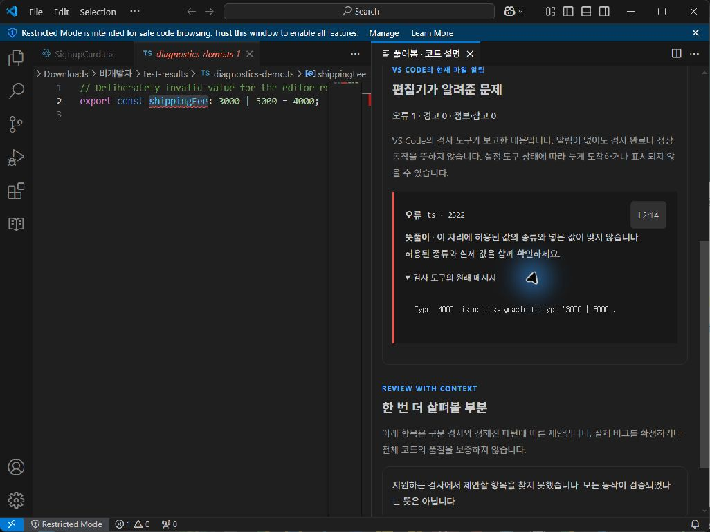

# Understand the editor's reports

Pureobom 0.6 connects VS Code's current-file diagnostic reports to its Review view. A compact summary shows reported errors and warnings while you read or edit. Open it to see severity, reporting tool, code, the original message and an exact source range. TypeScript reports `2304`, `2322`, `2339` and `2345` also have a short Korean/English explanation; other reports retain their original text without a guessed translation.

## Try a real type constraint

1. Open [typedShipping.ts](../examples/typedShipping.ts) in VS Code with its built-in TypeScript extension enabled.
2. Run **Pureobom: Explain current file**, choose **Rules**, and change `shippingFee` from `3000` to `4000`.
3. Review the diff and apply. The syntax is valid, but `4000` is outside the declared `3000 | 5000` type.
4. Open **Editor reports**. TypeScript's `2322` report explains the mismatch. The location button selects the reported identifier in the actual editor.
5. Use the editor's normal undo command. The report clears when TypeScript publishes its updated result.

한국어: **규칙 바꾸기**에서 배송비를 `4000`으로 변경해 적용한 뒤 **편집기 알림**을 누르세요. “이 자리에 허용된 값의 종류와 넣은 값이 맞지 않습니다”라는 뜻풀이와 검사 도구의 원래 메시지를 함께 확인할 수 있습니다. 위치 버튼은 원문을 선택합니다. `Ctrl+Z`로 되돌린 뒤 알림이 갱신되는 것을 확인하세요.

## What this evidence means

The reports come from the editor's installed checking tools and their project configuration. Pureobom reads [`languages.getDiagnostics`](https://code.visualstudio.com/api/references/vscode-api#languages.getDiagnostics) and listens for [`onDidChangeDiagnostics`](https://code.visualstudio.com/api/references/vscode-api#languages.onDidChangeDiagnostics); it does not launch a compiler, run project scripts, enable extensions or change workspace trust. The browser companion cannot supply these VS Code reports.

These APIs do not provide a diagnostic document version or a “checking finished” signal. Pureobom records the document version when it reads a report, not the version a provider checked. After an observed source edit it labels retained reports as possibly old and disables their navigation until another diagnostic event arrives. The next event is still only the latest available report, not a guarantee that all providers finished checking the latest code. If a provider emits no changed report, the pending label can remain; use VS Code's Problems panel and your normal project checks.

An empty report is always neutral: no reports are currently available. It is not a passed type check, a safe change or proof that the application works. Proposed changes are syntax checked only; type errors may appear after applying them. Current-file reports do not constitute a project-wide before/after comparison.

Reports are separate from Pureobom's syntax/pattern suggestions. They do not alter the source or invalidate a prepared change on their own. Source navigation validates both the active document context and report revision, so a replaced report or another file cannot reuse an old location. Up to 100 reports are shown, errors first; longer messages are shortened with a visible notice and omitted counts are shown. Messages render as text. Provider links, commands, related file URIs and automatic fixes are not forwarded or invoked. Report contents stay in the extension and are not added to voluntary feedback.

## Verification

Core checks cover ordering, counts, exact ranges, source-specific explanations, limits, inert text rendering, empty results and stale navigation controls. VS Code integration checks use a controlled diagnostic collection to verify event delivery, removal, edits and file switching. A separate integration check enables the built-in TypeScript extension, applies the real `3000 → 4000` rule edit, waits for `2322`, selects the reported identifier and confirms that undo removes the error. This last check uses actual TypeScript diagnostics, not a fabricated successful result.
