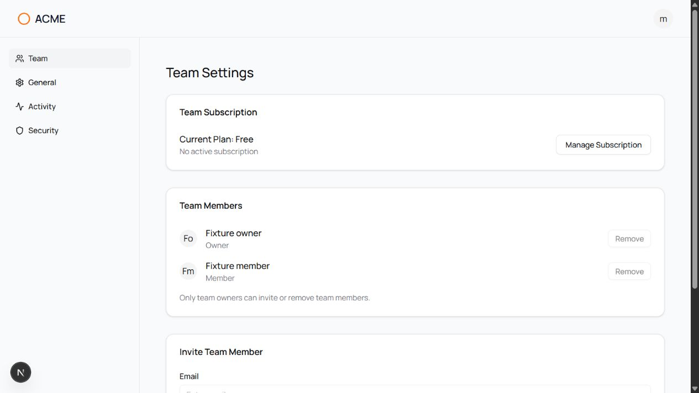
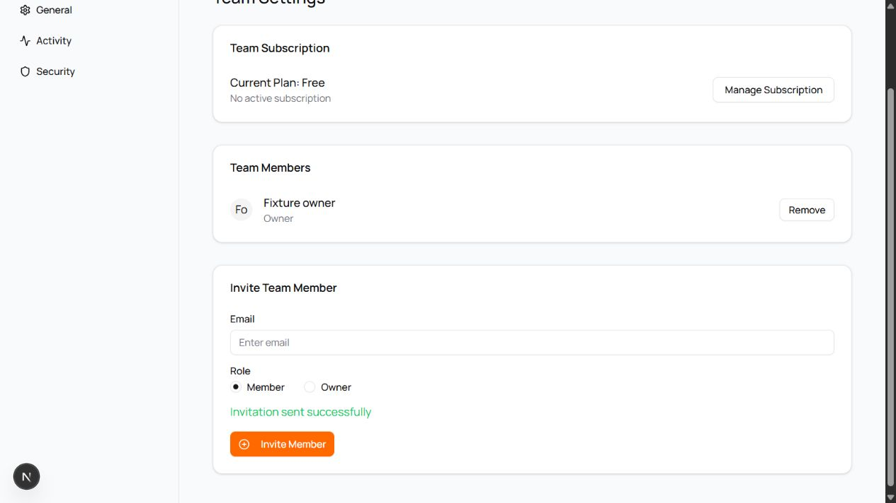

# 외부 앱 브라우저 검증과 Windows 작업 경로

2026-10-17. 대상과 잠금된 검사 환경은 [외부 Next 앱 재현 안내](../validation/next-saas-starter/README.md)와 같다. 실제 모델이 만든 후보의 앱 소스 4개와 추가 검사/설정 2개를 별도 복사본에 옮겨 실행했다. 복사 전후 SHA-256이 저장된 모델 작업과 같음을 확인했다. 사람의 사용성 시험이 아니며 검토자는 Codex 검증 에이전트다.

## 설치 UI 작업은 실패로 기록

설치 번들에서 업무 기능을 만들고 실제 Codex를 시작한 작업 `91f8c0ed-9a09-4c82-aa0f-12cdbeff771b`는 `failed`로 끝났다. 호스트가 직접 실행한 `test`는 esbuild의 긴 Windows 실행 경로에서 `ENOENT`로 실패했고 `typecheck`는 통과했다. 에이전트는 의존성 경로를 줄이려다 구현 제한 시간을 초과했다. [저장된 실패 상태와 원래 검사 출력](evidence/system-workspace/2026-10-17/external-next-installed-ui-failure.json)을 보존한다.

이 실행에는 완료된 UI 요청 보고서가 없고 검토·반영·undo를 완료하지 않았다. 별도 복사본에서 후보가 통과하더라도 이 실패 상태를 바꾸지 않는다. 에이전트가 추가한 `.gitignore` 변경과 `pnpm-workspace.yaml` 설치 설정도 앱의 권한 변경과 구분한다.

## 실제 앱에서 확인한 결과

| 범위 | 관측 결과 |
| --- | --- |
| 고정 인수 검사 | 이전 baseline 9개 중 4개 실패. 이번 후보는 9/9 통과, skip 없음 |
| 추가 회귀 검사 | 22/22 통과, skip 없음. 다른 팀·잘못된 FormData·정책 조건·화면 제어 포함 |
| 고정 입력 보존 | 원본·모델 작업·검증 복사본의 package.json, 잠금 파일, 인수 검사와 설정 해시 일치 |
| 실제 로그인 | 합성 member와 owner 계정의 로그인 성공, member 로그아웃 후 홈페이지 전환 |
| member 화면 | 두 Remove와 Invite Member 비활성, 제한 이유 표시. SQL 구성원/초대 불변, 로그인 활동만 추가 |
| owner 화면과 요청 | 계정 전역 role이 member여도 현재 팀 owner의 버튼 활성. 실제 초대 성공, member 제거 후 명단 갱신 |
| SQL 확인 | owner가 보낸 초대 1건, member 삭제, owner의 초대·제거 활동 로그가 화면 결과와 일치 |

근거: [고정 검사](evidence/system-workspace/2026-10-17/external-next-candidate-tests.json), [추가 검사](evidence/system-workspace/2026-10-17/external-next-candidate-extra-tests.json), [후보·고정 입력 해시](evidence/system-workspace/2026-10-17/external-next-native-candidate.json), [DOM 관측](evidence/system-workspace/2026-10-17/external-next-native-ui.json), [PostgreSQL 상태](evidence/system-workspace/2026-10-17/external-next-native-sql.json).

PGlite를 사용한 앞선 브라우저 시도에서는 원본 member의 잘못된 초대 성공과 수정 후보의 버튼 제한을 확인했지만, 동시 요청의 SQL 오류 때문에 owner 로그인을 완료하지 못했다. [부분 시도 기록](evidence/system-workspace/2026-10-16/external-next-ui-pglite-attempt.json)을 성공으로 취급하지 않는다. 이후 PostgreSQL 18.6의 새 로컬 클러스터에서 위 흐름을 확인하고 Next와 DB를 종료했다. 처음 재시작할 때 임시 설치 폴더에서 누락된 0바이트 의존성 파일은 별도 설치로 복원했다. 앱 구현이나 검사 기대값은 이 복구로 바꾸지 않았다.

## Windows 작업 경로 수정

Windows의 새 구현 작업은 코드 복사본을 사용자 홈의 `.pureobom/worktrees/<프로필 식별자>/<작업 UUID>`에 만든다. 깊은 VS Code 프로필 경로에 pnpm 의존성 경로가 더해지는 것을 줄인다. 검사 명령·패키지 설정을 바꾸거나 특정 검사 실행 파일을 우회하지 않는다. 사용자 홈이 매우 길거나 의존성 자체가 긴 경우까지 모든 Windows 도구의 경로 제한을 없애는 것은 아니다.

메타데이터·스냅샷·반영 기록은 기존 확장 저장소에 남는다. 프로필별 해시와 전체 작업 UUID로 경로를 분리하며, 복원 시 경로를 독립적으로 계산하고 심볼릭 링크와 Git 연결을 다시 검사한다. 기존 `implementation-jobs/<id>/worktree` 기록도 계속 읽는다. 작업 복사본을 OS 임시 폴더에 옮기거나 기존 작업을 자동 이동·삭제하지 않는다.

경로 회귀 검사는 긴 프로필 아래라면 260자를 넘을 esbuild 경로를 실제 짧은 복사본에서 실행하고, 다시 불러오기·반영·undo를 확인한다. 관련 작업 공간/복구 검사 17개와 확장 타입 검사가 통과했다.

외부 Next 앱의 새 작업 복사본에서도 `pnpm install --offline --frozen-lockfile --ignore-scripts`로 245개 패키지를 독립 설치했다. 같은 후보·고정 입력 해시를 유지하면서 고정 9개·추가 22개·타입 검사가 통과했다. esbuild 0.28.2의 실제 경로는 기존 배치라면 273자, 수정된 배치에서는 176자였다. `ESBUILD_BINARY_PATH`나 앱의 패키지 설정 변경 없이 실행했다. [직접 실행 기록](evidence/system-workspace/2026-10-17/external-next-compact-path.json)은 경로 수정의 근거이며 실제 모델 UI 전체 실행의 대체 증거는 아니다.

수정 VSIX를 설치하고 VS Code를 5회 독립 실행한 [복구 검증](evidence/system-workspace/2026-10-17/compact-path-installed-recovery.json)도 통과했다. 검토→반영→재시작 후 undo에 이어, 파일 3개 중 1개가 바뀌고 진행 기록은 아직 0개인 시점에 호스트를 강제 종료했다. 다음 실행에서 실제 파일을 대조해 원본과 Git index를 복구했다. 결정적 로컬 실행기를 사용한 호스트 검증이며 외부 모델·포인터 조작 시험은 아니다. VSIX SHA-256은 `96d666d55e1050211dae86c484973951fb6136bdff3d42513d9ce65d7f76dc08`이다.

검증 도구의 기존 `worktree` 폴더명 가정은 실제 Git worktree 파일 확인으로 바꾸고, 강제 종료 관측기는 코드 경로의 부모를 추측하지 않고 설정된 메타데이터 위치를 사용하도록 수정했다. 이 두 가정으로 실패한 중간 실행은 최종 5단계 성공에 포함하지 않았다.

## 남은 범위

수정한 확장을 새로 설치한 뒤 실제 모델과 UI의 검토·반영·재분석·undo를 다시 연결해야 한다. 네이티브 VS Code Webview 조작, 전체 Next production build, 인증·계정·결제 전체 회귀, 새 파일까지 포함한 외부 앱 재분석은 이 기록으로 완료하지 않는다. 일반 PostgreSQL 운영 동시성이나 보안 감사의 증거로도 일반화하지 않는다.
