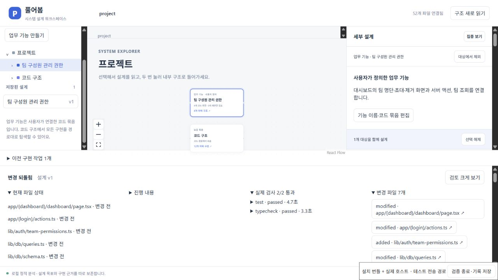

# 설치 화면에서 실제 모델로 외부 앱을 변경한 기록

2026-10-20. Windows의 VS Code 1.96.4 Production 확장 호스트, 설치된 0.7 개발판 번들, 실제 Codex CLI를 연결해 **설계 작성 → 구현 → 독립 검사 → 검토 → 반영 → 새 파일 재수집 → 되돌리기**를 완료했다. 대상은 고정된 Next.js SaaS Starter의 팀 구성원 권한 과제다. 실패했던 이전 실행은 [경로 문제](EXTERNAL_NEXT_BROWSER.md)와 [승인 대기 시간 초과](APPROVAL_WAIT.md)에 그대로 보존한다.

설치 번들의 JS/CSS를 브라우저로 조작하고, 테스트용 loopback 전송을 통해 실제 설치 호스트의 요청 처리기를 호출했다. 네이티브 VS Code Webview의 DOM·CSP·포인터 전달을 확인한 것은 아니다. 조작과 검토의 주체는 검증 에이전트이며 사람의 사용성 시험이 아니다.

## 실행과 근거

작업 ID는 `29da2265-df2a-4efc-b630-bc4f458f7d8a`, VSIX SHA-256은 `7e52db81873321c9cca6563b4521a9fdffb9ab7645806307be4c7588fc61c4f6`이다. Codex CLI는 `0.163.0-alpha.10.2`이며 모델을 별도로 지정하지 않았다. 버전·번들 해시는 [호스트 기록](evidence/system-workspace/2026-10-20/installed-next-ui.json)에 있다.

| 검증 항목 | 결과 |
|---|---|
| 설계 입력 | 업무 기능 하나에 대시보드, 서버 액션, 팀 조회, 팀 API를 연결. 원하는 동작·정책·유지 조건 3개·완료 기준 6개를 저장하고 구현 시작 |
| 실제 구현 | UI·서버 액션·조회·타입·공통 권한 함수·추가 테스트·설정의 7개 파일 변경 |
| 제품 독립 검사 | 고정 인수 검사 9/9, typecheck exit 0. 모델의 자체 보고와 구별 |
| 별도 복제본 검사 | 후보 7개 파일의 바이트 해시 일치. 고정 9개·추가 권한 21개·인증/계정/결제 코드 회귀 18개, typecheck 통과. skip 0 |
| 기존 동작 비교 | 변경 전 앱에서도 동일한 인증/계정/결제 코드 회귀 18개 통과 |
| 실제 앱 브라우저 | member 로그인·조회·비활성 초대/제거와 이유, 로그아웃, owner 로그인·초대·FormData 제거·명단 갱신 확인 |
| 실제 DB | PostgreSQL 18.6의 임시 데이터. member 조회 후 구성원·초대 불변, owner 초대 1건·구성원 제거·각 활동 기록 확인 |
| 검토 | 완료 기준 6개와 보호 파일 유지 조건 확인. 범위 밖 4개 및 추가 검사 파일 2개를 명시적으로 검토 |
| 반영·재분석 | 52→55개 파일. 새 파일 3개를 포함한 모든 변경 파일의 분석 해시가 후보와 일치. 관측 상태 `unchanged`→`changed` |
| 되돌리기 | 55→52개 파일, 전체 분석 파일 집합·해시 복원. 원본 추적 파일·HEAD·index·Git 상태 복원. 관측은 `unchanged`, 설계 v1과 목표 유지 |
| 종료 | UI 요청 오류 0개, 설치 호스트 최종 검사 exit 0. 별도 Next 서버와 PostgreSQL도 종료 |

[변경 내용·보호 파일 해시](evidence/system-workspace/2026-10-20/installed-next-candidate.json), [고정 검사](evidence/system-workspace/2026-10-20/installed-next-fixed-tests.json), [추가 권한 검사](evidence/system-workspace/2026-10-20/installed-next-extra-tests.json), [회귀 검사 전](evidence/system-workspace/2026-10-20/account-regressions-baseline.json)·[후](evidence/system-workspace/2026-10-20/account-regressions-candidate.json)를 보관한다.

[앱 DOM 관측](evidence/system-workspace/2026-10-20/installed-next-browser-dom.json)과 [SQL 상태](evidence/system-workspace/2026-10-20/installed-next-browser-sql.json), [설치 화면 DOM](evidence/system-workspace/2026-10-20/installed-next-ui-dom.json), [대조 검증 결과](evidence/system-workspace/2026-10-20/installed-next-verification.json)를 별도로 연결한다. SQL 기록만으로 UI 상태를, 화면만으로 직접 API 거절을 주장하지 않는다.




[member 제한 화면](evidence/system-workspace/2026-10-20/installed-next-member.jpg)과 [owner 초대·제거 결과](evidence/system-workspace/2026-10-20/installed-next-owner.jpg)도 확인할 수 있다.

## 미확인으로 남긴 두 유지 조건

인증·계정·결제 코드 회귀 18개는 실제 앱 액션, bcrypt, JWT, SQL과 Stripe webhook 서명을 사용한다. Next 쿠키/redirect는 검사 fixture가 제공하고 Stripe 원격 SDK 메서드는 지정한 응답을 반환한다. 해당 결제 검사에서 예상하지 않은 HTTPS 요청은 거절한다. 실제 청구, 운영 인증 환경, 결제 전체 또는 모델의 모든 외부 요청 부재를 입증한 것은 아니므로 첫 유지 조건 전체는 미확인으로 남겼다.

모델은 작업 내 캐시를 이용한 오프라인 설치와 다운로드 0건을 보고했다. 설치 명령 전체의 독립 실행 로그를 수집하지 않았으므로 세 번째 유지 조건도 미확인이다. 두 항목의 상태를 바꾸지 않고 이를 인지하는 선택을 한 뒤 임시 원본에 반영했다. 실제 사용자 프로젝트의 승인으로 일반화하지 않는다.

별도 브라우저 복제본의 첫 실행은 설치된 `server-only/empty.js`와 `client-only/index.js`가 없어 실패했다. 불완전한 의존성 폴더를 보존하고, 별도 새 캐시에서 잠금 파일을 유지한 채 245개 패키지를 다시 다운로드·설치하자 두 빈 파일이 복원됐다. 앱 후보 코드는 바꾸지 않았다. 이후 48개 검사와 타입 검사를 다시 실행하고 브라우저 검증을 완료했다. 이 복제본의 온라인 설치를 모델 작업 공간의 오프라인 설치 증거로 사용하지 않는다.

전체 Next production build, 네이티브 Webview 전달, 실행 중 에이전트 재연결, 더 깊은 설계/코드 의미 비교, 사람의 실제 사용성과 재사용 검증은 남아 있다. 이 사례의 성공은 전체 제품 완료를 뜻하지 않는다.

## 재현과 기록 대조

[설치 화면 드라이버](INSTALLED_DESIGN_UI.md)의 실제 모델 모드에 [외부 앱 준비 절차](../validation/next-saas-starter/README.md)로 커밋한 로컬 저장소를 전달한다. 구현 작업 복사본과 별도로 만든 복제본에서 추가 회귀 검사와 실제 앱 브라우저 확인을 수행한다. UI에서 검토 기록 저장·반영·되돌리기 후 `검증 종료·기록 저장`을 누르면 호스트 기록을 얻는다.

이 실행의 저장된 자료를 다시 대조하려면 저장소 루트에서 다음을 실행한다. 이는 기록 일관성 검사이며 새로운 모델 실행이나 브라우저 재현을 대신하지 않는다.

```sh
node validation/next-saas-starter/verify-installed-evidence.mjs docs/evidence/system-workspace/2026-10-20/installed-next-ui.json docs/evidence/system-workspace/2026-10-20/installed-next-candidate.json docs/evidence/system-workspace/2026-10-20/installed-next-browser-sql.json test-results/installed-next-verification.json
```
