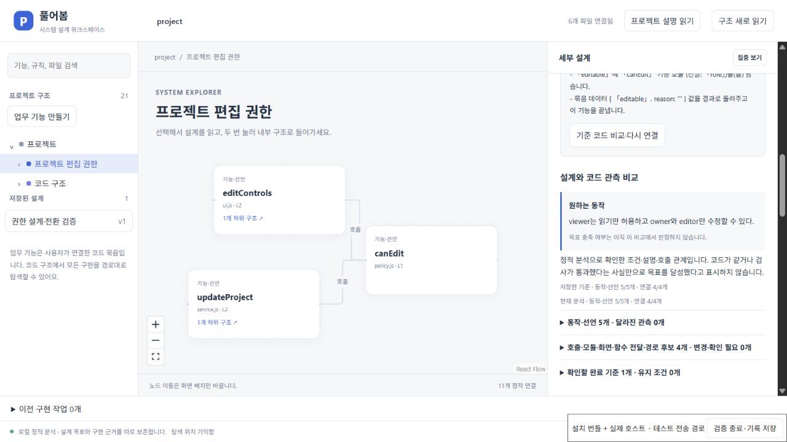
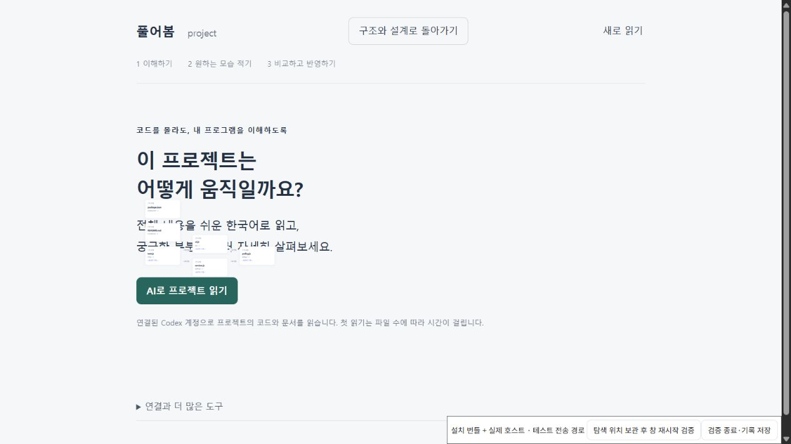

# main의 프로젝트 읽기·언어 도구와 시스템 설계 통합

2026-10-20. `codex/system-design-workspace`의 `34f2ec4`에 `main`의
`88df675`를 통합했다. `main`이 앞선 설계 코드 `694bc81`을 복사해 포함한
이력을 확인하고, 그 내용을 기준으로 양쪽의 이후 변경을 대조했다.
47개 충돌을 해소했으며 add/add 파일의 대조 결과는
[병합 기록](evidence/main-integration/merge-resolution.json)에 남겼다.

첫 화면은 시스템 구조·설계 편집이다. **프로젝트 설명 읽기**로 한국어
읽기·수정 도구를 열고, 헤더의 **구조와 설계로 돌아가기**로 돌아온다.
기존 다중 파일 구현·검토·복구, 탐색과 초안 보관을 유지하면서 main의
프로젝트 읽기, 변경 설명, 언어별 읽기·제한된 편집 도구를 함께 제공한다.
언어별 도구의 지원을 모든 언어의 시스템 설계 자동 구현 지원으로 해석하지 않는다.

## 통합 중 발견한 문제

- 설치 검사가 읽기 Webview를 연 직후 `activeTextEditor`가 있다고 가정했다.
  실제 집중된 Webview와 분석 대상 문서를 각각 확인하도록 고쳤다. 이후 원문
  이동의 편집기 집중 검사는 유지했다.
- 탭 제목과 복귀 버튼을 시스템 설계 흐름에 맞췄다. 복귀 버튼은 접힌 보조
  메뉴에서 헤더로 옮기고 좁은 화면에서 헤더가 줄바꿈하도록 했다.
- 화면을 바꿔도 작성 중인 설계·탐색 상태를 보존한다. 숨긴 구조 화면은
  레이아웃을 유지하고 `inert`와 `aria-hidden`으로 조작·읽기 대상에서 제외한다.
  설명 화면은 React Activity로 상태를 보존한다.
- 노드를 드래그할 때 React Flow의 ResizeObserver 경고가 발생했다.
  [수정 전 오류와 직전 요청](evidence/main-integration/observer-errors-before-patch.json)을
  보존했다. 화면 전환만으로 발생한다고 단정했던 초기 추정은 시간 기록으로
  좁혔다. [상류 수정안 #5999](https://github.com/xyflow/xyflow/pull/5999)의
  다음 프레임 일괄 갱신과 [#6054](https://github.com/xyflow/xyflow/pull/6054)의
  pane observer 정리를 검토해 ESM 번들에 적용했다. 오류 수집·실패 판정은
  그대로 유지했다. 버전·출처·적용 범위는 [패치 안내](../patches/README.md)에 있다.

## 검증과 실패 기록

[단위 검사 회차별 결과](evidence/main-integration/unit-runs.json): 처음에는
Go·Java·.NET SDK 미설정과 호스트 연결 시간 초과가 있었다. SDK를 지정한 회차의
Java 제한 시간 초과도 남겨 두었다. 무거운 설치 검사를 동시에 실행하지 않은
최종 회차는 **47개 파일·384개 검사 전부 통과**했다. 이 결과는 이후 UI 전용
observer 패치 이전의 통합 핵심 코드 검사다.

[최종 설치 화면 검사](evidence/main-integration/installed-design-ui.json)는
**요청 12개 성공·브라우저 오류 0개·모델 작업 0개**다. 기능 묶음 생성,
초안 작성→설명 화면→복귀, 설계 저장, 노드 이동·축소, 저장 설계 선택과
다른 확장 호스트에서 설계·선택·배율·노드 위치 복원을 확인했다. 원본 8개
파일과 Git 상태가 보존됐다. 설치된 JS/CSS와 production 호스트를 사용하지만
브라우저용 전송 경로로 검증했으며, 네이티브 Webview 포인터 조작의 증거는 아니다.

패치 직후 첫 회차에서도 두 번의 드래그 중 브라우저 오류는 없었다. 다만
재시작 뒤 검사자가 노드를 다시 움직여 저장 위치와 동일해야 한다는 종료
조건을 위반했다. 이 회차는 통과로 세지 않는다. 제품이나 검사 조건을
바꾸지 않고 정해진 순서로 다시 실행한 결과가 위의 최종 기록이다.

같은 VSIX의 [설치 통합 검사 57개](evidence/main-integration/installed-extension-integration.json)도
통과했다. 실제 Python·Go·Java·C# 파서, Rust WASM, HTML/CSS/JSON/SQLite 도구의
원문 이동·제한된 편집·diff·반영·undo와 오래된 변경 거절을 포함한다. 모델 관련
사례는 제어된 응답을 사용하므로 새 모델의 설명 정확성을 입증하지 않는다.

[여섯 단계 설치 복구 기록](evidence/main-integration/installed-recovery.json)은
수정하지 않은 네이티브 Webview의 시작·메시지 왕복·닫기와 다시 열기,
검토 대기 복원, 반영·undo, 반영 도중 호스트 종료와 후속 복구를 확인한다.
원본 여섯 파일과 staged/unstaged 변경, HEAD·index를 보존했다. 네이티브
시작 통신 외의 복구 동작은 검증된 호스트 dispatcher를 호출했다.
VS Code의 인증 제공자 대기·N-API 종료 경고가 출력됐지만 최종 검사 종료 코드는 0이었다.

세 설치 기록의 VSIX SHA-256은
`bcebcb3f9f3127937898f85bdb57f5a1ebec5ff803d0755dcb30c0f1b5a61e5a`로 같다.
확장 빌드·패키징과 `pnpm install --frozen-lockfile`도 통과했다. 패치는
소스 ZIP에 포함하며 릴리스 검사가 원본 패치·출처·pnpm 설정의 바이트 일치를 확인한다.

웹 빌드, 기록 데모 생성, 22개 파일의 사이트 패키지, 32개 파일의 사용자 관찰
검토 패키지, 릴리스 생성·검사도 통과했다. 릴리스 검사에는 체크섬·소스 목록·
VSIX·라이선스·추출된 Worker와 Python/Go/Java/C#/Rust 도구의 실제 실행이 포함된다.
사이트 패키지를 생성한 것이며 GitHub Pages를 활성화하거나 공개 배포하지 않았다.

전체 기획의 사람 관찰과 공개 사이트 검증은 여전히 별도 과제다.
이번 통합을 제품 전체 완료, 새 AI 구현 성공, 모든 언어·환경 지원으로 표시하지 않는다.
