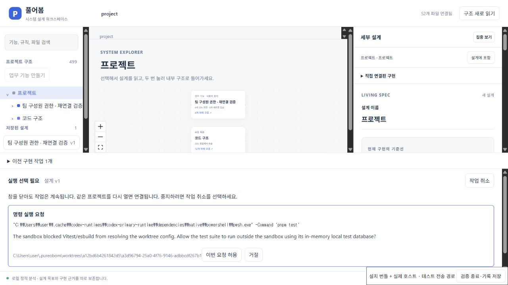
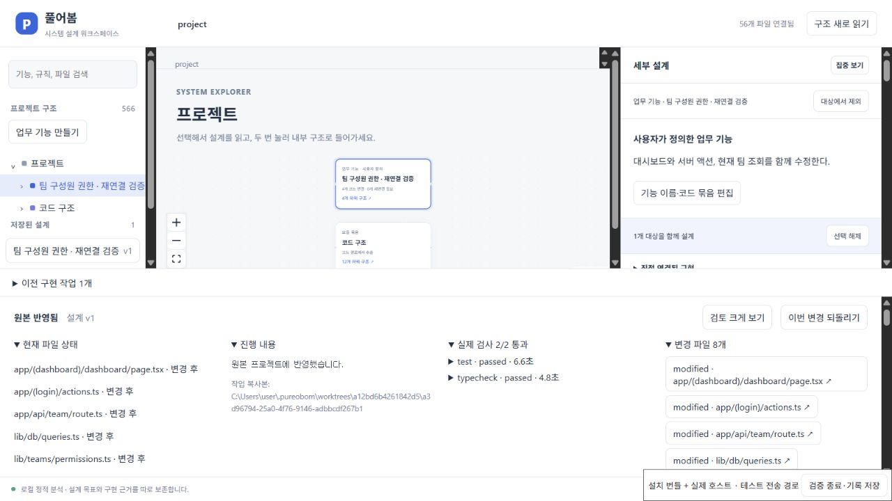
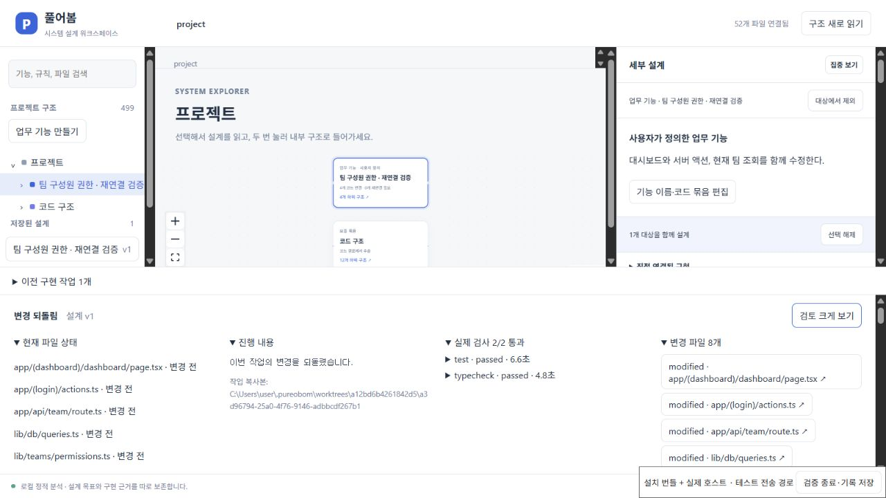

# 실제 Codex 작업의 창 종료·재연결 검증

2026-10-20. Windows의 VS Code 1.96.4에 설치한 개발판과 Codex CLI `0.163.0-alpha.10.2`로 외부 Next.js 앱의 팀 권한을 변경했다. 실제 검사 승인 대기 중 편집기를 종료하고 같은 프로젝트·프로필로 다시 열었다. 동일한 Codex 프로세스와 승인을 이어받아 구현·검사·검토·반영·되돌리기를 완료했고 두 설치 호스트 모두 종료 코드 0으로 끝났다.

작업 ID는 `a3d96794-25a0-4f76-9146-adbbcdf267b1`이다. 모델을 별도로 지정하지 않았으며, VSIX SHA-256은 `56ea33d2582fe02a4e584ce4e9d2e3c600753dda8017be15174cef06e0736397`이다. 이는 [관리 프로세스 구현](MANAGED_AGENT_HOST.md)의 설치 시험에 사용한 같은 제품 번들이다. 이번 변경은 검증 드라이버·문서·증거에 한정된다.

## 관측한 실행

| 항목 | 결과 |
|---|---|
| 시작 | 업무 기능에 대시보드·서버 액션·팀 조회·팀 API 4개 파일 연결. 설계 v1과 실행 설정을 보관하고 구현 1회 요청 |
| 창 종료 전 | `pnpm test` 실행 승인 ID `0` 대기. 확장 호스트 PID `20248` |
| 창 재연결 후 | 새 확장 호스트 PID `2680`. 작업 ID·작업 공간·승인 내용 동일 |
| 프로세스 대조 | 관리 프로세스 PID `38800`, Codex PID `20488`와 각각의 생성 시각·Codex 실행 경로가 전후 동일 |
| 이어 실행 | 복원된 인수 검사 요청과 후속 추가 검사 요청을 각각 검토·허용. 동일 작업이 검사·검토 단계까지 진행 |
| 변경안 | 연결된 앱 파일 4개 수정, 공유 권한 함수와 추가 검사/설정 파일 4개 추가, 총 8개 |
| 제품 독립 검사 | 잠긴 인수 검사 9개 통과, typecheck 종료 코드 0 |
| 별도 실행한 추가 검사 | 3개 파일의 50개 모두 통과, skip 0. 고정 9개 + SQL 권한 회귀 35개 + 화면 연결 회귀 6개 |
| 보호 파일 | 기존 인수 검사·설정·package.json·pnpm-lock.yaml 4개의 SHA-256 불변 |
| 반영 | 실제 원본 파일 8개가 검토한 후보 해시와 일치. 새 파일 4개를 포함해 분석 파일 수 52→56 |
| 되돌리기 | 분석 파일 집합·해시 56→52 복원. 추적 파일 57개의 해시·HEAD·index·Git 상태 복원. 설계 v1과 목표 보존 |
| 요청/화면 오류 | 기록된 요청 19개 모두 성공, 브라우저 client error 0개 |

[호스트 원본 보고서](evidence/system-workspace/2026-10-20/managed-live-ui.json)의 `reconnection`에 전후 프로세스·작업·승인이 들어 있다. [후보와 보호 파일](evidence/system-workspace/2026-10-20/managed-live-candidate.json), [추가 검사 원자료](evidence/system-workspace/2026-10-20/managed-live-extra-tests.json), [반영된 실제 파일 해시](evidence/system-workspace/2026-10-20/managed-live-applied-files.json), [기록 및 원본 대조 결과](evidence/system-workspace/2026-10-20/managed-live-verification.json)를 함께 보존한다. 제품 관리 프로세스 변경의 [Windows·Linux CI](https://github.com/him55710-sudo/no-dev/actions/runs/39288714238)도 성공했다. 이번 실제 모델·프로세스 대조는 Windows에서 수행했다.

재시작 [전 화면](evidence/system-workspace/2026-10-20/managed-live-before.jpg)과 DOM 관측 [전](evidence/system-workspace/2026-10-20/managed-live-before.txt)·[후](evidence/system-workspace/2026-10-20/managed-live-reconnected.txt)·[반영](evidence/system-workspace/2026-10-20/managed-live-applied.txt)·[되돌림](evidence/system-workspace/2026-10-20/managed-live-undone.txt)도 보관한다. DOM 기록의 임시 전송 URL은 제거했다.

## 검증 범위

설치 번들의 UI를 브라우저에서 조작하고 테스트용 loopback 전송으로 실제 Production 확장 호스트를 연결했다. VS Code 네이티브 Webview의 DOM·CSP·포인터 전달은 확인하지 않았다. 검토는 검증 에이전트가 수행했으며 사람의 사용성 검증이 아니다.

추가 SQL 검사는 실제 서버 액션·JWT·Drizzle·임시 PGlite를 사용한다. 화면 검사 6개는 실제 페이지의 action 연결을 호출하되 React hook·SWR·서버 액션 응답을 mock한다. 같은 후보를 실제 앱 브라우저에서 조작하지 않았으므로 화면 비활성화/설명과 성공 후 화면 갱신 두 완료 기준은 부분 근거를 적고 미확인으로 남겼다. 로그인·결제 전체 유지와 모델/설치 전체의 외부 접근 부재도 확인하지 않았다. 총 9개 기준 중 5개를 확인하고 4개를 미확인으로 보존한 채 임시 원본의 반영·복원을 시험했다. 이전 [별도 후보의 실제 앱 브라우저 검증](INSTALLED_NEXT_FLOW.md)을 이번 후보의 증거로 사용하지 않는다.

창을 다시 열면 탐색 대상이 프로젝트 루트로 돌아왔고 저장된 설계를 직접 선택해 이어갔다. 탐색 위치의 자동 복원은 남아 있다. 관리 프로세스 자체의 종료 후 잔류 Codex 확인·재개, 다른 OS의 실제 모델 재연결, 전체 Next production build, 더 깊은 목표·구현 비교와 사람의 재사용 검증도 남아 있다. 이번 실행은 전체 기획의 완료 보고서가 아니다.

## 재현

[설치 화면 드라이버](INSTALLED_DESIGN_UI.md)의 실제 모델 모드에 `PUREOBOM_RECONNECT_UI=1`을 추가한다. [외부 Next 앱 준비 절차](../validation/next-saas-starter/README.md)로 커밋한 로컬 기준선을 전달하고, 실제 승인 대기 때 `승인 대기 중 창 재시작 검증`을 누른다. 다음에 출력되는 브라우저 주소에서 같은 승인을 검토하고 나머지 흐름을 완료한다. 프로세스 관측 방식 때문에 이 선택 모드는 Windows와 실제 Codex를 요구한다. 일반 CI는 기존 결정적 실행기 경로를 유지한다.

드라이버의 TypeScript 검사와 잘못된 재연결 설정의 실행 전 거절을 확인했다. 이 문서의 50개 앱 검사는 제품 자체의 214개 회귀 검사와 별개다.
