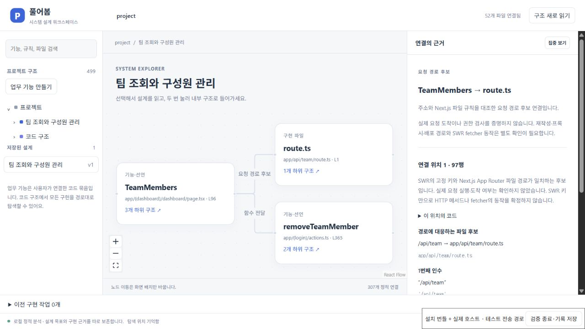
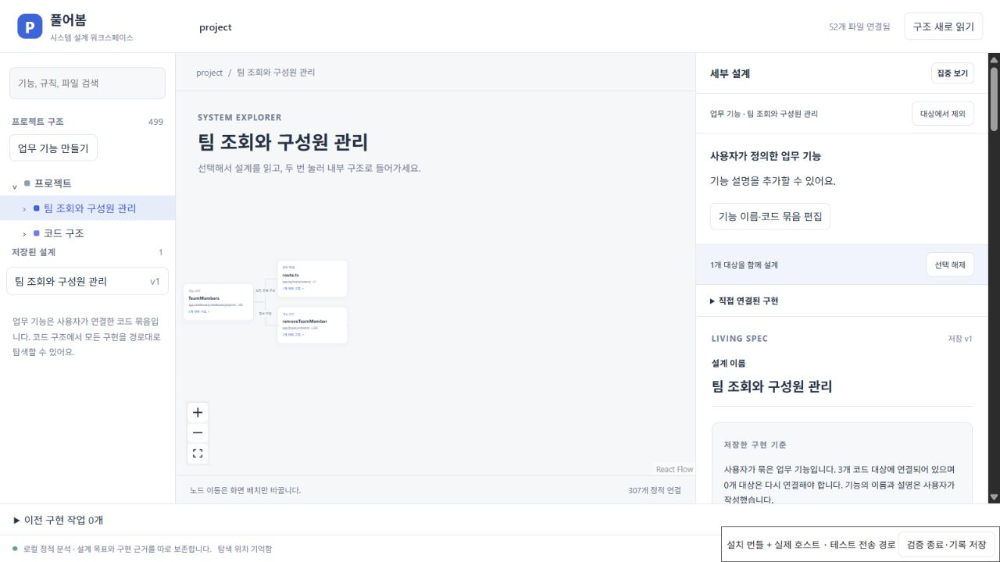

# 화면 주소와 Next.js API 파일 연결

함수 import가 없어도 화면과 서버가 HTTP 주소로 연결되는 경우가 있다. 구조 화면은 이제 `fetch('/api/team')`의 고정 주소와 SWR의 고정 키를 Next.js App Router 파일에 대응시켜 **요청 경로 후보**로 표시한다. 연결을 선택하면 요청 위치의 전달식·주변 조건과 대상 API 파일을 함께 읽고, 두 대상을 설계 범위에 넣을 수 있다.

기존 `calls`·`renders`·`passes`·`imports`는 컴파일러 근거를 유지한다. 새 `routes`는 `evidence: framework`로 구분하며, 실제 요청이 실행되거나 해당 서버에 도착했다는 뜻으로 사용하지 않는다. 후보 파일과 그 내부 구현은 검토할 변경 범위에 포함된다. 권한 정책의 충족은 별도의 검사와 검토가 필요하다.

## 무엇을 연결하는가

- 프로젝트 최상위 `package.json`에 Next.js 의존성이 있고, 분석한 파일 안에서 App Router 규칙을 확인할 수 있을 때 적용한다.
- 로컬 선언·인수·import가 가리지 않은 `fetch`와 `swr`의 default import를 읽는다. 이름이 같은 다른 함수와 tsconfig가 로컬 파일로 바꾼 `swr`는 구분한다.
- 첫 인수의 문자열 또는 보간 없는 템플릿에 고정된 `/...` 경로가 있으면, 쿼리·해시를 제외한 경로와 `app/.../route.ts`·`route.js`를 대조한다. 로컬 파일은 하나 이상의 호출 가능한 HTTP 메서드 export를 가져야 한다.
- `(group)` 폴더는 URL에서 제외한다. 최상위 `app/`가 있으면 `src/app/`를 후보로 쓰지 않는다. 같은 URL에 여러 파일이 대응하면 자동 연결하지 않고 확인 필요로 남긴다.
- 동적 주소·배열 키·함수 키·간접 변수, 동적 세그먼트·병렬·가로채기·private 경로, Pages Router, 프록시·재작성·basePath·배포 설정은 해석하지 않는다. 외부 URL을 로컬 API와 연결하지 않는다. 파일·코드의 원문 탐색은 그대로 남는다.

SWR는 키와 fetcher를 분리하므로 URL처럼 보이는 키가 반드시 HTTP 요청은 아니다. UI에서도 이 차이를 표시한다. `fetch`의 `method`, 다른 옵션과 SWR의 fetcher 인수는 원문 구문으로 남기며, 경로 후보를 특정 HTTP 메서드의 실행 증거로 바꾸지 않는다. 프로젝트의 설정·앱·fetcher 코드를 실행하지 않고 분석한다.

근거로 사용한 공식 규칙: [Next.js Route Handlers](https://nextjs.org/docs/app/api-reference/file-conventions/route), [Route Groups](https://nextjs.org/docs/app/api-reference/file-conventions/route-groups), [src 폴더 우선순위](https://nextjs.org/docs/app/api-reference/file-conventions/src-folder), [SWR의 key와 fetcher](https://swr.vercel.app/docs/api). 정적 경로 대응은 이 규칙을 적용한 후보 추론이며 런타임 검증과 구분한다.

## 저장과 비교

원래 컴파일러 연결을 모두 만든 다음 경로 후보를 추가하므로, 기존 연결의 ID·원문·근거 해시는 보존한다. 요청 위치의 전체 구문과 후보 파일 경로를 근거 해시에 포함한다. 같은 주소라도 그 위치의 옵션·메서드·fetcher 인수 표현이 바뀌면 관측 비교에 드러난다. 별도 함수의 본문까지 이 후보 해시가 대표하지는 않는다. 이전 관측 형식도 계속 읽으며, 새 후보는 새 관측으로 나타나고 사용자가 저장한 목표는 유지된다.

## 재현

```powershell
pnpm exec vitest run tests/workspace-routes.test.ts
node scripts/check-route-candidates.mjs '<준비한 Next baseline Git 폴더>' 81dccd7
```

두 번째 명령은 이전 커밋의 분석기와 현재 분석기를 같은 외부 앱 파일에 적용하고 `test-results/route-candidates.json`을 기록한다. 파일 내용·Git HEAD·스테이징·작업 상태가 그대로인지도 대조한다.

2026-10-20 외부 Next 앱 비교: 52개 분석 파일에서 새 후보 5개를 찾았다. `AccountFormWithData`·`InviteTeamMember`·`UserMenu`는 `app/api/user/route.ts`, `ManageSubscription`·`TeamMembers`는 `app/api/team/route.ts`에 대응한다. 기존 컴파일러 연결 302개와 모든 노드·원문 참조를 그대로 보존했고, 전체 연결은 307개다. 원본 추적 파일 57개와 Git 상태도 보존됐다. 새 후보를 실제 HTTP 실행 또는 목표 달성의 증거로 일반화하지 않는다.

## 2026-10-20 설치본과 회귀 검증

최종 코드로 전체 회귀 267개와 실제 VS Code 설계 호스트 검사 39개가 통과했다. 앱·확장 빌드와 VSIX 패키징도 통과했다. 경로 후보의 여섯 검사는 고정 요청, SWR 별칭과 로컬 tsconfig 별칭 구분, 가려진 함수, 잘못된 경로, App Router 우선순위·충돌, 이전 저장 형식과 목표 보존, 구현 범위에 API·정책 포함, 요청 옵션 변경의 관측 비교를 확인한다. 구현 전 다섯 검사가 실패한 기록도 보존한다.

설치된 VSIX의 JS/CSS와 실제 Production 확장 호스트를 연결해 외부 Next 앱의 `TeamMembers`, `removeTeamMember`, `app/api/team/route.ts`를 **팀 조회와 구성원 관리** 기능으로 묶었다. 캔버스에 서버 액션의 **함수 전달**과 API 파일의 **요청 경로 후보**가 따로 나타나고, 후보를 선택하면 `/api/team` 대응과 fetcher 인수를 읽을 수 있었다.



원문 이동 세 건을 실제 편집기 선택 텍스트와 대조했다. 요청 후보는 화면 97행의 `useSWR<TeamDataWithMembers>('/api/team', fetcher)` 전체, 함수 전달은 101행의 `removeTeamMember`, API 파일은 1행부터의 파일 내용과 정확히 일치했다. 두 연결의 근거 해시는 저장된 설계 관측의 해시와 같았다.

원하는 동작으로 “팀 조회는 현재 팀 구성원에게 허용하고, 구성원 제거는 소유자만 가능하게 한다. 화면과 서버에서 같은 팀 권한을 확인한다.”를 저장했다. 화면 재로딩과 같은 실행 호스트에 새 브라우저 탭으로 다시 연결한 뒤에도 저장 v1, 목표 문장, 세 대상과 연결이 복원됐다. 저장한 관측은 동작·선언 10개, 연결 20개였다. 이 검증에서는 설계만 저장했으며, 목표를 구현하거나 달성했다고 판정하지 않았다.



호스트 요청 27개가 모두 성공하고 클라이언트 오류와 모델 작업은 0개였다. 원본 추적 파일 57개, Git HEAD·스테이징·작업 상태를 비교해 보존을 확인했다. 설치 기록의 VSIX SHA-256은 `ec223f547d76509d5528d24c22c2b99c1836941f7a62e306872ca8294fbe4a27`이며, 확인한 패키지는 1,839,147바이트다.

이 화면 검증은 브라우저에서 설치 번들을 조작하고 테스트 전송 경로로 실제 VS Code 호스트를 호출한 결과다. 네이티브 VS Code Webview 자체의 DOM·포인터 전달은 미검증으로 남긴다. 기존 권한 변경의 실제 모델·브라우저·SQL 검증과 이번 구조 탐색 검증은 별개다.

기록: [구현 전 실패](evidence/routes-before.json), [전체 회귀](evidence/routes-regression.json), [설계 호스트](evidence/routes-design-host.json), [외부 앱 전후 비교](evidence/route-candidates.json), [설치본 요청·저장 설계](evidence/routes-installed-ui.json), [원문·해시·보존 대조](evidence/routes-installed-audit.json).

[연결선의 전달값과 주변 구문](CONNECTION_EVIDENCE.md) · [관측 비교](WORKSPACE_OBSERVATIONS.md) · [전체 구현 기준](SYSTEM_WORKSPACE_STATUS.md)
