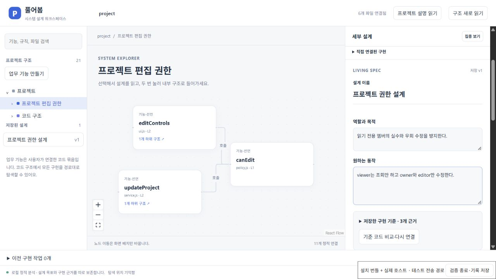
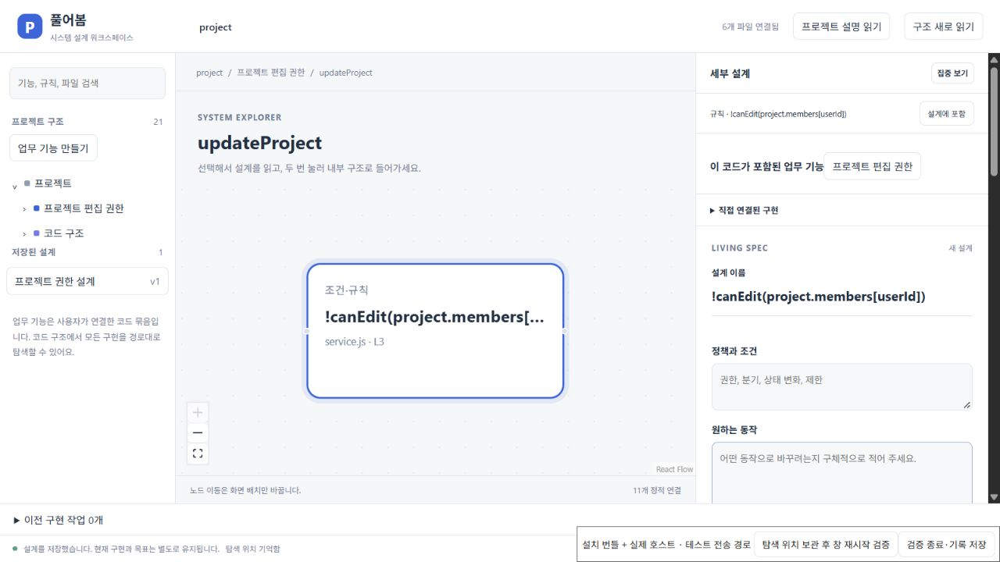

# 선택 수준에 맞춰 설계를 먼저 편집하기

2026-10-20. 기획의 ‘상위에서는 역할과 경계, 규칙에서는 조건과 결과’를
설계 패널의 입력 순서에 반영했다. 이전에는 기능 전체의 긴 코드 설명과
관측 비교가 모든 입력보다 먼저 나와 목표를 쓰기 전에 여러 화면을 내려야 했다.

| 선택한 대상 | 먼저 편집하는 항목 | 나머지 세부 항목 |
|---|---|---|
| 프로젝트·모듈·업무 기능·파일, 서로 다른 종류의 묶음 | 역할과 목적 → 원하는 동작 | 접어서 시작하며 작성된 항목 수를 표시 |
| 규칙만 선택한 묶음 | 정책과 조건 → 원하는 동작 | 역할·입출력·예외를 펼쳐서 시작 |
| 함수·선언만 선택한 묶음 | 입출력과 데이터 → 원하는 동작 | 역할·정책·예외를 펼쳐서 시작 |

모든 항목은 기존 Living Spec에 그대로 저장한다. 접기는 화면 표현만 바꾸며
코드·목표·기준 설명을 줄이거나 삭제하지 않는다. `유지해야 하는 동작`과
`완료 기준`은 계속 독립된 입력란으로 제공한다. 저장한 구현 기준과 관측 비교는
별도로 펼쳐 읽을 수 있고, 원문 링크·기준 재연결·이전 기준 기록도 유지한다.
코드 변경 경고는 접는 영역 밖, 목표 입력 앞에 표시한다.

## 실제 설치 화면에서 확인한 것

[설치 UI 기록](evidence/progressive-spec/installed-ui.json)은 VSIX의 실제 JS/CSS와
production 확장 호스트를 브라우저 전송 경로로 연결한 결과다.
**요청 26개 성공·브라우저 오류 0개·모델 작업 0개**이며 다음을 확인했다.

- 기능 → 함수 → 규칙을 선택하면 역할·입출력·정책의 우선순위가 바뀐다.
- Enter 키로 세부 항목과 비교 근거를 열고 닫을 수 있다. 규칙의 `service.js:3`
  링크로 실제 원문 이동 요청이 성공한다.
- 제목·역할·목표·정책·입출력·예외·유지 조건·완료 기준을 모두 작성하고 저장한 뒤,
  다른 대상을 선택하거나 설명 화면을 왕복하고 호스트를 재시작해도 그대로 복원한다.
- 테스트 저장소의 권한 함수를 외부에서 바꾸면, 구현 기준이 접혀 있어도
  재검토 경고가 표시된다. [변경·복원 기록](evidence/progressive-spec/external-change.json)으로
  확정된 설계 파일 전체가 바뀌지 않았음을 확인했다. 원본 바이트를 복구한 뒤
  다시 분석하면 변경된 관측 0개로 돌아온다.
- 노드 이동과 축소 후 새 호스트에서 설계·선택·캔버스를 복원했다. 원본 8개
  파일과 Git 상태가 보존됐다.

첫 수정에서는 설명만 접었고 목표 입력이 여전히 아래에 있었다.
[첫 시도 화면](evidence/progressive-spec/first-collapsed-attempt.png)을 보고
입력 순서를 추가로 바꿨다. 첫 회차는 재시작 검증을 마치기 전에 종료했으므로
통과 기록에 포함하지 않는다.

## 검증 범위

확장 타입 검사·빌드·패키징과 변경 파일 형식 검사를 통과했다. 최종 VSIX는
`34f83c39294e01988ca1784e1af5108bee6998624893a4e1eebcf4e02bc76793`이다.
이전 통합본과 extension/worker/agent-host 번들의 바이트는 같으며 설계 JS/CSS가
달라졌다. 위 설치 화면 검증은 새 번들을 사용했다.

직전 통합 커밋 `21283fb`의 [Windows·Ubuntu CI](https://github.com/him55710-sudo/no-dev/actions/runs/39348098674)는
모두 성공했다([실행 상태](evidence/progressive-spec/integration-ci.json)). 그 결과를
이번 UI 변경의 새 CI 결과로 취급하지 않는다. 네이티브 Webview 전체 포인터 흐름,
비개발자·숙련 개발자의 실제 판단이나 탐색 시간 개선은 아직 입증하지 않았다.
