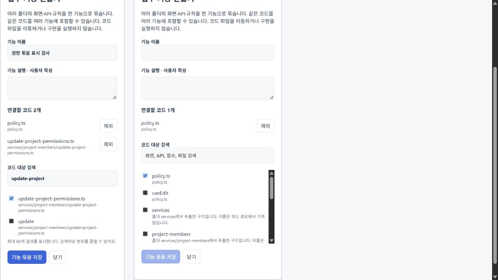

# 설계 대상과 연결 후보 표시

2026-10-20. 구조에서 설계 대상을 선택하면 관련 구현 후보를 트리·검색 결과·캔버스에서 함께 표시한다. 기존 구현 범위 계산을 사용하며 구현 계약, 원본 파일, 사용자 목표를 변경하지 않는다.

## 표시의 의미

- **설계 대상**: 선택한 파일·함수·규칙·업무 기능과 그 하위 코드.
- **연결 후보**: 기존 정적 분석의 호출·함수 전달·렌더링·요청 경로 등으로 수집한 관련 코드. 실제 수정 여부나 요구 충족을 뜻하지 않는다.
- **대상 포함 / 연결 후보 포함**: 해당 코드가 들어 있는 파일·폴더·업무 기능. 같은 컨테이너의 관계없는 함수까지 후보로 확장하지 않는다.
- 연결된 후보 사이의 선을 강조한다. 단순 import 선은 강조 근거에 포함하지 않는다. 후보 파일 수에는 설계 대상도 들어가므로 화면에 **대상 포함**이라고 명시한다.

색과 함께 문구를 표시하고 캔버스의 접근성 이름에도 구분을 넣었다. 프로젝트를 처음 열었을 때 전체 구조가 모두 강조되는 것을 피하고, 구체적인 대상을 고르거나 전체 프로젝트의 원하는 동작을 작성하면 표시한다. 실제 수정 내용은 구현 뒤 변경 검토에서 확인한다.

TypeScript Compiler API로 추출한 기존 관계를 React Flow 카드와 연결선에 투영한다. Dagre 배치와 프로젝트별 탐색 저장을 유지하며 새 라이브러리는 추가하지 않았다.

## 코드 검증

[검증 원자료](evidence/scope-highlighting/validation.json)에 실제 소스 분석을 이용한 검사를 기록했다.

- UI·API·테스트에서 같은 정책을 호출할 때 대상과 후보, 상위 컨테이너를 구분한다.
- 같은 파일의 관계없는 함수, 다른 파일, 겹치는 업무 기능의 무관한 구성원을 강조하지 않는다.
- 파일 전체를 선택한 경우 그 안의 코드를 대상으로 포함한다. 사라진 선택에는 표시를 만들지 않는다.
- 입력 그래프와 기존 구현 범위를 바꾸지 않는다.

관련 10개 검사 파일의 56개가 통과했다. 이어 테스트 파일 후보에 대한 검증을 보강한 범위 표시 검사 3개도 통과했다. 이 3개는 앞선 56개에 포함된 검사의 갱신이며 59개로 합산하지 않는다. 최초 확장 빌드에서 Map 타입 추론 오류가 있었고 명시적 타입으로 수정한 뒤 웹·확장 빌드와 VSIX 패키징을 통과했다.

직전 `749695b`의 [Windows·Ubuntu CI](https://github.com/him55710-sudo/no-dev/actions/runs/39351153526)는 모두 성공했다. 이번 변경의 CI 결과와 구분한다.

## 네이티브 조작 시도와 발견한 화면 문제

Windows Computer Use로 설치된 VS Code의 실제 Webview를 조작했다. 원래 HTML/CSP, `acquireVsCodeApi`, 설치 JS/CSS를 유지했다. `PUREOBOM_NATIVE_UI=1` 검사 모드는 실제 호스트 요청을 관찰하고 브라우저의 제품 요청 경로를 거절한다. 재시작·종료는 별도 검사 제어다.

실제 화면에서 `policy.js` 선택에 따른 UI·서비스·테스트 후보 표시, 업무 기능 생성·저장, 내부 진입, 카드 이동과 원하는 동작 입력을 관찰했다. 초안 보관 문구도 표시됐다. 그러나 시험은 **60분 제한으로 exit 1 종료**됐고 저장 설계 선택·재시작·최종 검증 단계에 도달하지 않았다. 요청 보고서가 저장되지 않아 성공 요청 수나 네이티브 JavaScript 오류 수를 주장하지 않는다. 종료 후 별도 디스크 검사로 원본 8개 파일의 해시·HEAD·index·Git 상태 보존을 확인했다.

이 시도에서 코드 선택 체크박스가 공통 입력 스타일의 `width: 100%`를 물려받아 파일명을 가로 화면 밖으로 미는 문제를 발견했다. 코드 목록에서 체크박스 너비를 `auto`로 바꾸고 긴 이름과 경로의 줄바꿈을 허용했다.

수정 후 실제 `FeatureEditor`와 CSS를 사용한 별도 브라우저 컴포넌트 화면에서 320px·380px 패널의 파일명, 긴 경로, 검색→선택→저장을 확인했다. 저장 결과는 두 코드가 선택된 것으로 표시됐다. 이 검사는 설치 호스트의 재실행 결과가 아니다. 수정 전 네이티브 설치본과 수정 후 VSIX의 해시는 원자료에서 구분한다.

## 재현

`pnpm exec vitest run tests/workspace-scope-highlight.test.ts`로 실제 소스 관계의 범위 표시를 검사한다. `node scripts/preview-feature-picker.mjs`는 실제 컴포넌트를 사용하는 320px·380px 화면의 로컬 주소를 출력한다. 좁은 패널에서 이름 입력 → `update-project` 검색 → 파일 체크 → 기능 묶음 저장을 수행하면 `2개 연결`이 표시된다. 이 화면의 저장은 컴포넌트 검증용 메모리 상태이며 프로젝트에 설계를 저장하지 않는다.

네이티브 재검증은 확장을 빌드·패키징한 뒤 PowerShell에서 `$env:PUREOBOM_DESIGN_UI='1'`, `$env:PUREOBOM_NAVIGATION_UI='1'`, `$env:PUREOBOM_NATIVE_UI='1'`을 설정하고 `pnpm extension:design-ui-test`로 시작한다. 별도 프로필의 실제 VS Code 화면을 조작하며, 코드 목록 화면만 확인했다고 전체 흐름을 통과시키지 않는다.

## 남은 검증

최종 설치본의 네이티브 저장·재시작·구현·검토·반영·복구 전체 조작은 남아 있다. 에이전트의 기술 검증을 사람의 사용성 검증으로 대체하지 않으며 참가자와 측정 결과는 0건이다. [원래 관찰 계획](USER_STUDY.md)과 전체 기획 범위를 유지한다.
