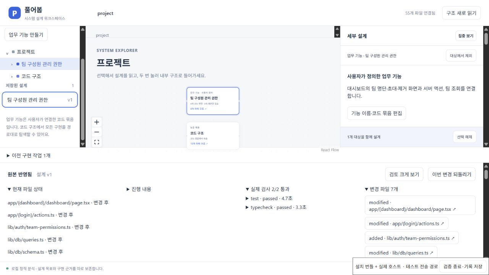

# 실제 앱의 설계 변경을 따라 보기

**구조 선택 → 설계 수정 → 여러 파일 구현·검사 → 검토·반영 → 재분석·되돌리기.**

0.7 개발판의 기록 안내는 `public/workspace-demo.html`이다. `pnpm build` 후 `node scripts/serve.mjs`를 실행하고 [로컬 실행 기록](http://127.0.0.1:4173/workspace-demo.html)을 연다. 소스와 데모 ZIP에 포함한다. 기존 hosted 영상은 이전 단일 파일 체험이며, 새 안내의 공개 사이트 배포는 별도다.

이 페이지는 **실제 실행의 기록을 읽는 안내**다. 모의 화면을 제품처럼 조작하게 하거나, 새로운 AI 실행·작업 시간 측정이라고 설명하지 않는다. 스크린샷을 확대하고 접힌 근거를 펼쳐 볼 수 있으며, 스크립트 없이 읽을 수 있다.

## 성공 사례

2026-10-20의 [설치 UI·실제 Codex 실행](INSTALLED_NEXT_FLOW.md), 작업 `29da2265-df2a-4efc-b630-bc4f458f7d8a`를 사용한다. 이후 이어하기 실행의 결과와 섞지 않는다.

1. **구조와 범위**: 대시보드·서버 액션·팀 조회·팀 API를 사용자가 하나의 업무 기능에 연결했다.
2. **설계**: 현재 팀 owner만 초대·제거하고 member는 조회하도록 목표·정책·유지 조건·완료 기준을 저장했다.
3. **구현과 검사**: 실제 Codex가 7개 파일을 바꿨다. 제품의 고정 인수 9개·타입 검사와, 같은 후보의 독립 복제본에서 추가 권한 21개·계정 코드 회귀 18개를 확인했다.
4. **검토와 반영**: 범위 밖 파일과 검사 파일을 검토하고 미확인 유지 조건 두 개를 남긴 시험용 원본에 반영했다. 분석 52→55개, 새 파일의 분석 해시와 후보 해시 일치를 확인했다.
5. **되돌리기**: 55→52개와 원본 파일·Git 상태를 복원했다. 설계 목표는 남았다.



설치 번들 화면은 실제 확장 호스트와 테스트용 브라우저 전송으로 연결했다. 네이티브 Webview의 전체 포인터 전달은 미검증이다. 앱 브라우저와 PostgreSQL 결과는 같은 후보의 별도 검증이며, 운영 인증·결제 전체나 사람의 사용성을 증명하지 않는다.

## 서버 검사 누락의 실패 재현

`scripts/test-permission-failure.mjs`는 별도 임시 Git 복제본에서 같은 성공 후보를 사용한다. 결정적 시험 실행기가 서버 권한 검사 두 곳만 의도적으로 제외하고 UI·독립 인수 검사는 유지한다. 실제 모델이 이 오류를 만들었다고 설명하지 않는다.

실제 구현 관리자가 검사 실패 후 수정을 한 번 요청한다. 시험 실행기는 같은 오류를 반복한다. 최종 인수 검사 7개 통과·2개 실패, 타입 검사는 통과한다. **같은 검토 ID로 반영을 요청해도 검사 실패 때문에 거절**된다. 누락한 서버 검사만 복원한 후보에서는 동일 인수 검사 9개가 통과한다. 원본 앱과 Git 상태는 보존한다.

[실패·반영 거절·복구 원자료](evidence/system-workspace/2026-10-20/missing-server-guards.json). 이 실패 사례는 CLI 구현 관리자를 사용하며 새로운 브라우저 또는 네이티브 Webview 실행이 아니다.

재현하려면 [외부 앱 안내](../validation/next-saas-starter/README.md)에서 준비한 baseline Git 저장소를 전달한다. 이 드라이버는 기록된 후보의 원본 해시가 정확히 일치할 때만 진행한다.

```powershell
node scripts/test-permission-failure.mjs '<준비된 외부 baseline Git 폴더>'
```

첫 승인 대기에서 출력된 분리 작업 복사본에 `pnpm install --offline --frozen-lockfile --ignore-scripts`로 의존성을 설치한다. 필요하면 기존 pnpm store 경로와 `--package-import-method copy`를 지정한다. 두 번의 시험 파일 승인 각각을 확인한 뒤 `{"id":"fault-files","decision":"accept"}`를 입력한다. 새 원자료는 `pureobom-failure-demo-*/report.json`에 남는다.

## 안내 자산의 대조

```sh
pnpm demo:record
pnpm build
pnpm release:package
pnpm release:check
```

`demo:record`는 저장된 성공·실패 결과를 대조하고 네 장의 원본 스크린샷을 바이트 그대로 복사한다. `public/media/system-workspace/evidence.json`에 작업 ID, 결과, 이미지 해시, 검증 범위를 보관한다. 자료 대조는 새로운 모델 실행이나 화면 조작을 대신하지 않는다.

2026-10-20 배포 파일 확인: 프로덕션 빌드와 release package/check를 통과했고, 데모 ZIP의 안내 HTML·CSS·근거 JSON·네 장의 이미지가 소스 자산과 바이트 단위로 일치했다. 로컬 브라우저에서 [안내 첫 화면](evidence/system-workspace/2026-10-20/walkthrough-page.png), 실제 파일 목록 펼침, 반영 섹션 이동과 되돌리기 기록 펼침을 확인했다. 이 확인은 기록 안내 페이지의 표시 검증이며, 새 AI 구현 실행이나 모바일·네이티브 VS Code 화면 검증은 아니다.

[설치와 첫 변경](SYSTEM_WORKSPACE_START.md) · [지원 환경](SYSTEM_WORKSPACE_SUPPORT.md) · [전체 기획과 남은 검증](SYSTEM_WORKSPACE_STATUS.md)
