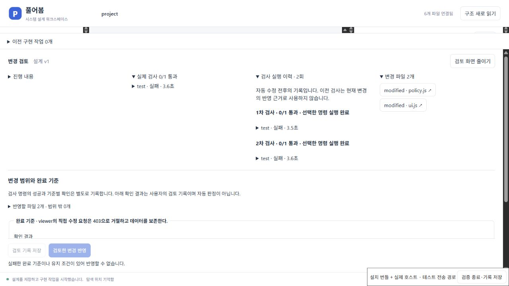
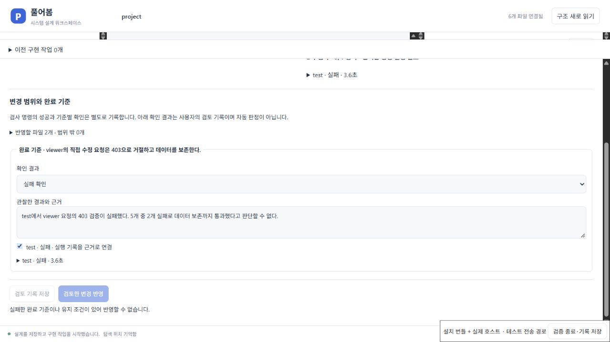

# 실패를 지우지 않는 검사·검토 기록

2026-10-20. 설계의 완료 기준과 유지 조건에는 통과 여부뿐 아니라 실패·시간 초과·실행하지 못한 검사도 근거로 남길 수 있어야 한다. 자동 수정으로 최종 검사가 통과해도 앞선 실패가 사라져서는 안 된다.

## 수정한 동작

기존 구현은 한 차례 자동 수정 뒤 `checks`를 새 검사 목록으로 교체했고, 앞선 실패 결과를 별도로 보존하지 않았다. 기준별 검토는 통과한 명령만 연결할 수 있어 실패한 기준에 실제 실패 로그를 연결하지 못했다. 출력은 마지막 24,000자로 제한했지만 생략 사실이 화면에 표시되지 않았다.

이제 각 검사 회차의 완료된 명령 결과와 회차 완료 여부를 작업 기록에 보존한다. 자동 수정에 들어가기 전에 첫 회차를 저장하며, 다음 회차가 실패하거나 일부만 실행되어도 앞선 기록은 유지한다. 현재 검사 결과와 과거 실행 이력은 화면에서 구분한다. 이력은 현재 변경의 반영 허가나 기준별 확인 근거로 재사용하지 않는다.

실패·시간 초과·명령 없음 결과를 **실패** 또는 **미확인** 기준에 연결하고 관찰 내용을 저장할 수 있다. **사용자가 직접 확인**한 기준에는 통과한 검사만 연결할 수 있다. 연결은 사용자의 검토 기록이며, 명령 결과를 특정 요구사항의 충족·위반으로 자동 판정하지 않는다. 알려진 실패 기준과 통과하지 못한 현재 검사는 계속 원본 반영을 차단한다.

실행 결과에는 한국어 상태, 경과 시간과 사용 가능한 종료 코드를 표시한다. 앞부분이 생략된 출력에는 마지막 24,000자만 보관됐다고 표시한다. 이전 버전의 기록은 새 필드 없이 계속 읽는다. 이미 버려진 과거 로그를 복원하거나 생략 여부를 추정해 만들지는 않는다.

## 재현

```powershell
pnpm exec vitest run tests/implementation-review.test.ts tests/agent-verification.test.ts tests/agent-verification-history.test.ts tests/agent-recovery.test.ts
pnpm build
pnpm extension:build
pnpm extension:package
$env:PUREOBOM_DESIGN_UI='1'
$env:PUREOBOM_VERIFICATION_UI='1'
pnpm extension:design-ui-test
```

검사 이력 회귀는 별도 Git 저장소에서 실제 stdio 구현 경로와 실제 `node --test` 검사를 실행한다. 제어된 시험 실행기가 첫 회차에서 서버의 403 상태 코드를 누락한다. 한 사례는 다음 회차에 고쳐 통과하고, 다른 사례는 고치지 않아 다시 실패한다. 외부 AI 추론을 실행하지 않으며 시험 자체를 실제 모델의 수정 능력으로 설명하지 않는다.

설치 UI 검증은 같은 실패를 두 번 만드는 별도 시험 프로필을 연다. 화면에서 설계의 목표·완료 기준을 입력하고 실행기 설정을 저장해 구현을 시작한다. 시험용 파일 요청 두 건을 허용한 뒤 검사 이력을 열고, 완료 기준에 실패 결과·관찰 내용·`test` 기록을 연결해 저장한다. 반영 버튼의 차단을 확인하고 검증 종료를 선택한다. 종료 검사는 저장 기록 복원과 공통 호스트 처리기의 반영 거절, 원본 파일·Git 보존을 대조한다. 네이티브 Webview 포인터 전달과는 별도 검증이다.

## 확인한 결과

구현 전에는 새 검사 세 개가 각각 실패했다. 첫 검사 이력 누락, 생략 표시 누락, 실패 로그 연결 거절을 재현한 [초기 결과](evidence/verification-before.json)를 남겼다. 최종 전체 회귀는 [271개 통과](evidence/verification-regression.json), 실제 VS Code [설계 호스트 39개 통과](evidence/verification-design-host.json)이며 앱·확장 빌드와 패키징도 통과했다.

실제 시험 실행에서 [첫 실패 뒤 수정 통과](evidence/verification-repaired.json)와 [두 회차 모두 실패](evidence/verification-failed.json)를 따로 확인했다. 첫 사례는 검사 명령 종료 코드가 1→0, 둘째는 1→1이며 원래 인수 검사 파일을 바꾸지 않았다. 별도 작업 관리자를 다시 열어 이력과 현재 검사, 저장한 실패 기준을 복원했다. 검토 기록 없는 통과 후보와 검사가 실패한 후보 모두 반영이 거절됐고 원본 Git 상태가 유지됐다. CI도 이 두 기록을 수집한다.

최종 VSIX를 설치한 UI에서는 권한 함수 `canEdit`를 선택하고 설계를 저장해 시험 구현을 실행했다. 두 회차의 실제 명령은 각각 5개 중 3개 통과·2개 실패였다. 화면 변경과 정책 변경만으로 서버 오류의 403 상태 코드 검사를 통과하지 못한 사례다. 실제 변경 파일은 `policy.js`, `ui.js` 두 개였다. 시험 응답기의 진행 문구가 아니라 실제 Git 변경 목록과 검사 결과로 확인했다.



완료 기준을 `실패 확인`으로 지정하고 관찰 내용과 실패한 `test` 기록을 연결해 저장했다. 새로고침 후 같은 실패 결과·메모·검사 연결·이력이 복원되고 반영 버튼이 비활성화됐다. 종료 시 설치 호스트의 공통 처리기에 반영을 직접 요청해 거절되는 것도 확인했다. 검사 실행 자체는 실패해야 하는 시험이며, 제품의 저장·복원·차단 검증은 성공했다.



[설치 UI 기록](evidence/verification-installed-ui.json)의 요청 13개가 모두 성공하고 클라이언트 오류는 0개였다. [원본·패키지 대조](evidence/verification-installed-audit.json)에서 원본 추적 파일 8개와 Git HEAD·스테이징·작업 상태를 보존했다. 설치된 VSIX는 1,840,058바이트이며 SHA-256은 `27f87bb1156e4f4dee84c177a4ebcfb95add79aaead8b4312a17cbdb1423f337`이다.

이 결과는 제어된 시험 실행기와 설치 번들·실제 호스트의 동작을 검증한다. 외부 모델의 수정 능력, 자유로운 요구사항의 자동 충족 판정, 사람의 사용성 효과 또는 네이티브 Webview 포인터 전체 전달을 입증하지 않는다.

[기준별 검토](IMPLEMENTATION_REVIEW.md) · [구현 실행](AGENT_IMPLEMENTATION.md) · [전체 기획 기준](SYSTEM_WORKSPACE_STATUS.md)
