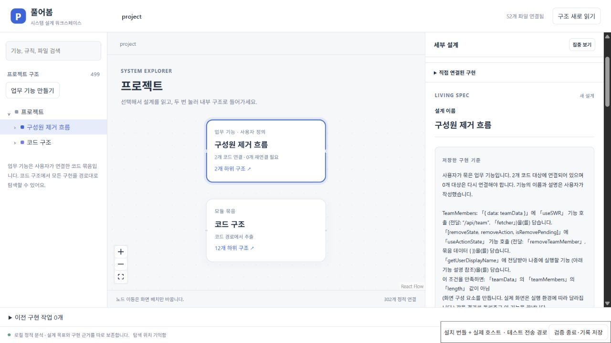

# 보고 있던 구조와 설계 이어 보기

0.7 개발판의 시스템 설계 화면은 프로젝트별 탐색 위치를 같은 VS Code 프로필에 보관한다. 창이나 설계 탭을 다시 열면 선택한 코드·연결선, 업무 기능을 거친 탐색 경로, 선택한 저장 설계·초안, 함께 설계할 대상, 펼친 트리, 검색어, 집중 보기와 캔버스 위치를 복원한다. 확대율·이동 위치와 직접 옮긴 노드의 배치는 탐색 범위별로 기억한다.

하단의 **탐색 위치 기억함**은 마지막 변경의 저장이 끝난 상태다. 보관 중에는 별도로 표시하고, 쓰기에 실패하면 **현재 탐색 위치 다시 보관**으로 재시도한다. 저장 완료 전 창을 강제로 종료하면 마지막 조작이 남지 않을 수 있다.

**풀어봄: 선택한 코드를 시스템에서 보기**를 실행하면 현재 편집기의 위치를 우선한다. 이전 화면의 늦은 저장 응답으로 이 선택을 되돌리지 않는다. 프로젝트를 전환하는 동안 끝난 저장 결과도 새 프로젝트의 상태를 변경하지 않는다.

## 코드가 달라졌을 때

다시 읽은 구조에서 살아 있는 ID와 탐색 경로만 복원한다. 선택한 대상이 없어졌으면 남아 있는 상위 위치로 돌아갔다는 안내를 표시한다. 같은 이름의 다른 함수를 대신 선택하지 않는다. 유효한 저장 설계나 초안의 선택은 유지하며, 설계의 기준 코드 재연결은 기존의 명시적 비교·확정 절차를 따른다.

탐색 위치의 보관은 프로젝트 코드, 설계 목표, 실행 설정을 변경하거나 구현을 시작하지 않는다. 노드 이동도 화면 배치만 바꾼다. 기록은 프로젝트의 `.pureobom` 문서와 별도로 확장 로컬 저장소에 두며 Git 커밋이나 팀원 간 동기화의 대상이 아니다. 같은 프로젝트를 여러 창에서 탐색하면 마지막 저장이 다음 복원 위치가 된다.

## 구현과 재현

React Flow의 `defaultViewport`, `onMoveEnd`, `onNodesChange`를 사용하고 드래그 중 매 프레임의 상태는 메모리에만 둔다. 드래그가 끝났을 때와 방향키로 노드를 옮겼을 때 배치를 보관한다. Zod로 버전·프로젝트 키·허용 필드·좌표·크기를 검사하고 임시 파일 쓰기 후 교체한다. 저장 요청은 순서대로 처리하며 대기 중인 여러 조작은 최신 상태로 합친다. 저장을 기다리는 중 원래 선택으로 돌아간 경우도 마지막 상태를 보관한다.

- [React Flow 공식 API](https://reactflow.dev/api-reference/react-flow)
- [저장·복원 모델 검사](../tests/workspace-navigation.test.ts)
- [실제 확장 호스트 검사](../extension/test/designWorkspace.ts)
- [설치 UI 검증 도구](../scripts/test-installed-design-ui.mjs): `PUREOBOM_DESIGN_UI=1`, `PUREOBOM_NAVIGATION_UI=1`로 실행한다. 실제 설치 번들과 Production 호스트를 사용하고 브라우저 전송 경로에서 저장 응답을 800ms 늦춰 연속 조작도 확인한다. 업무 기능·설계를 만들고 내부로 탐색한 뒤 노드 배치·확대율을 바꾸고, 하단 재시작 검증 버튼으로 다른 확장 호스트에서 복원한다. `검증 종료·기록 저장`은 원본 파일·Git 상태 보존과 구현 미실행을 검사한다.

설치 검증은 브라우저에서 설치 번들의 실제 UI를 조작하는 범위다. 네이티브 VS Code Webview의 포인터 전달, 다른 OS·프로필 사이의 동기화 또는 사람의 사용성 검증을 의미하지 않는다.

## 2026-10-20 Windows 설치 검증

[설치 호스트 기록](evidence/system-workspace/2026-10-20/navigation-installed-ui.json)과 [독립 대조 결과](evidence/system-workspace/2026-10-20/navigation-verification.json)를 보존했다. VS Code 1.96.4 Production 모드, VSIX SHA-256 `5a27af427a2bfc6c622803d294f065e5f262f5a102f2ceb67d4e0e357594e10e`에서 확인했다.

- 화면 요청 27개 모두 성공, 탐색 저장 17개, 클라이언트 오류 0개, 구현 작업 0개.
- `공유·권한`에 UI·서버·정책 파일을 묶고 `policy.js → canEdit`에 설계를 저장했다. 업무 기능을 거친 3단계 경로, 선택 함수, 저장 설계, 함께 설계할 대상, 펼친 트리와 범위별 배치를 복원했다.
- 검색어를 입력한 직후 지운 상태가 실제 저장 요청 두 개에 순서대로 남았다. 검색어와 집중 보기를 켠 뒤 브라우저를 새로고침해 복원을 확인했다.
- 방향키로 옮긴 `(35, 35)` 위치와 이후 마우스로 옮긴 위치가 저장 기록에 남았다. 최종 노드 좌표 `(67, 약 3)`, 뷰포트 `(157.5, 75.5)`, 확대율 `1.25`가 호스트 PID `13908 → 36312` 재시작 전후 일치했다. 렌더링된 DOM의 노드·뷰포트 스타일도 같았다.
- 저장 설계 전체, 원본 파일 8개 SHA-256, Git HEAD·인덱스·상태가 보존됐다. 코드와 구현 작업을 변경하지 않았다.
- [확장 호스트 검사 32개](evidence/system-workspace/2026-10-20/navigation-host-integration.json)와 웹·확장 빌드가 통과했다. 탐색 모델·저장 검사 6개는 전체 회귀 실행에도 포함된다.

전체 회귀 실행은 **219개 통과·1개 실패**였다. 기존 관리 프로세스의 첫 클라이언트 실행이 실패했고, 작업 시작 약 29초 뒤 승인 기록이 만들어졌다. 해당 검사에는 30초 실행 제한이 있으나 당시 오류에 종료 신호 정보가 없어 시간 초과를 확정 원인으로 주장하지 않는다. 제한이나 제품 코드를 바꾸지 않은 **해당 파일의 단독 재실행 4개는 통과**했다. 첫 실행을 전체 통과로 바꾸지 않는다. 남아 있던 합성 테스트 작업은 정확한 프로젝트·작업 ID의 관리 연결로 취소했고 승인 0개·관리 프로세스 종료를 확인했다. 검사 실행기 실패 경로의 정리와 Windows 시작 시간 안정성은 별도 개선 대상으로 남는다.

[재시작 전](evidence/system-workspace/2026-10-20/navigation-before.jpg) · [재시작 후](evidence/system-workspace/2026-10-20/navigation-after.jpg) · [검색·집중 보기 복원](evidence/system-workspace/2026-10-20/navigation-focus.jpg)

## 2026-10-20 후속: 겹치는 탐색 저장

이전 Windows CI에서는 호스트가 저장한 `공유 탐색`이 빈 문자열로 덮이는 실패가 있었다. 캔버스의 자동 배치 완료도 전체 탐색 상태를 저장하므로, 화면에 남은 오래된 검색어를 뒤늦게 쓸 수 있었다. 이제 화면은 바뀐 필드만 보내고 호스트가 최신 상태에 합친다. 캔버스 변경은 탐색 범위별로 합쳐 다른 범위의 배치를 보존한다. 저장 설계 해제는 명시적인 빈 선택으로 전달한다.

화면마다 저장 요청 하나만 진행하며, 기다리는 동안의 입력은 별도 보관한다. 호스트 상태와 응답에 순번을 붙여 오래된 응답이 최신 상태를 되돌리지 않게 했다. 쓰기 실패 후에도 마지막 입력을 표시하고 명시적 재시도나 다음 조작으로 다시 저장한다. 화면을 떠난 뒤에는 남은 대기 입력을 보내지 않으며, 코드에서 새 대상으로 이동한 경우 이전 탐색 세대의 입력을 재사용하지 않는다.

첫 설치 실행은 `ResizeObserver` 오류 한 건 때문에 재시작 검사에서 실패했다. [당시 화면·오류 기록](evidence/system-workspace/2026-10-20/navigation-writes-initial-browser.json)을 별도로 보존한다. 자동 배치 콜백에서 부모 외부 저장소를 즉시 갱신하는 경로를 발견해 캔버스 저장을 다음 프레임으로 옮기고 범위 종료 시 취소하도록 했다. 이는 크기 변경 관측 중 재배치가 발생하는 경로를 줄이는 수정이다. 오류 메시지만으로 모든 원인을 확정하지 않으며, 오류 수집·실패 조건을 완화하지 않았다. 동작 원리는 [MDN ResizeObserver 설명](https://developer.mozilla.org/en-US/docs/Web/API/ResizeObserver#observation_errors)을 참고했다.

수정 설치본의 [호스트 기록](evidence/system-workspace/2026-10-20/navigation-writes-installed-ui.json)과 [화면 대조](evidence/system-workspace/2026-10-20/navigation-writes-browser.json)는 다음을 확인한다.

- 요청 23개 성공, 탐색 저장 14개, 브라우저 오류 0개, 구현 작업 0개. 응답을 800ms 늦추는 전송 경로는 그대로 유지했다.
- 검색어 `canEdit`, 직후 지운 빈 검색어, 집중 보기를 각각 화면 재로딩 후 확인했다.
- 호스트 PID `32520 → 16224` 재시작 전후 함수 선택, 저장 설계, 업무 기능을 거친 경로, 펼친 트리, 노드 `(35, 35)`와 확대율 `1.041666…`를 복원했다. DOM의 노드·뷰포트 스타일도 같았다.
- 원본 파일 8개, Git HEAD·인덱스·상태와 저장 설계를 보존했다. 설치 VSIX SHA-256은 `9cfe5d48885014dda678789edce4ac5f5803b54bce98dd44318947df7dcfe124`다.
- [요청 순서 검사](../tests/navigation-writer.test.ts)는 늦은 캔버스 쓰기, 연속 입력과 지우기, 오래된 응답, 쓰기 실패와 재시도, 화면 종료, 새 코드 선택과 범위별 병합을 검사한다. 실제 호스트 검사는 겹치는 검색·캔버스 요청을 포함한다.
- 최종 [전체 회귀 241개](evidence/system-workspace/2026-10-20/navigation-writes-regression.json), [호스트 검사 34개](evidence/system-workspace/2026-10-20/navigation-writes-host-integration.json), 웹·확장 빌드를 통과했다. 탐색 관련 14개 검사는 전체 회귀에도 포함되므로 별도로 더해 집계하지 않는다. [독립 대조와 소스 해시](evidence/system-workspace/2026-10-20/navigation-writes-verification.json)를 함께 보존한다.

[재시작 전](evidence/system-workspace/2026-10-20/navigation-writes-before.jpg) · [재시작 후](evidence/system-workspace/2026-10-20/navigation-writes-after.jpg) · [집중 보기 복원](evidence/system-workspace/2026-10-20/navigation-writes-focus.jpg)

## 2026-10-20 후속: 기능 저장 뒤 선택 유지

처음 업무 기능을 만들면 루트에 사용자 기능과 `코드 구조` 묶음이 생긴다. 기존 코드 경로를 이 구조에 맞추는 동안 탐색 세대가 바뀌었는데, 화면의 저장 완료 콜백은 교체 전 탐색 기록기에 새 기능 선택을 전달했다. 그 결과 저장은 성공해도 이전 코드 선언이 계속 선택됐다. [수정 전 확장 호스트 검사](evidence/system-workspace/2026-10-20/feature-navigation-before.json)에서도 새 기능 대신 `ProjectEditor`가 남는 실패를 재현했다.

이제 기능 저장을 처리하는 호스트가 최신 구조 분석을 기다린 뒤 선택과 루트 경로를 함께 보관한다. 생성·편집한 기능의 설계가 바로 열리고, 기능을 해제하면 프로젝트로 돌아간다. 이전 검색어·묶인 대상·저장 설계 선택을 정리하고, 늦은 이전 탐색 요청은 새 선택을 덮지 못한다. 첫 묶음 생성으로 루트 구성이 달라지면 화면을 다시 맞춘다. 기존 노드 위치와 내부 범위의 확대·이동 기록은 유지한다. 코드 수정이나 모델 실행은 시작하지 않는다.

첫 수정 설치본에서 선택 유지는 확인했으나 이전 축소율이 남아 새 카드가 작게 보였다. [중간 실행 기록](evidence/system-workspace/2026-10-20/feature-navigation-before-fit-ui.json)과 [당시 화면](evidence/system-workspace/2026-10-20/feature-navigation-before-fit.jpg)을 보존한다. 루트 화면 맞춤까지 적용한 별도 설치본에서 다시 검증했다.

- [최종 설치 호스트 기록](evidence/system-workspace/2026-10-20/feature-navigation-installed-ui.json): 요청 122개 성공(초안 저장 100개, 탐색 저장 15개 포함), 클라이언트 오류 0개, 모델 작업 0개. 원본 추적 파일 57개와 Git HEAD·인덱스·상태 보존.
- `TeamMembers`를 검색해 선택한 상태에서 화면과 `removeTeamMember`를 묶었다. 새 기능 선택과 검색어 정리, 읽을 수 있는 카드 크기를 확인했다. 선택 세대는 생성 `0→2`, 이름 편집 `2→3`, 해제 `3→5`로 바뀌었고 각 완료 시점의 선택을 호스트가 검사했다.
- 이름을 `구성원 제거·권한`으로 편집하고 목표와 완료 기준을 저장했다. 화면 재로딩 뒤에도 해당 기능과 저장 설계를 확인했다. 내부 전달 연결선에서 실제 101행의 `removeTeamMember` 범위를 열었다. 묶음 해제 후 프로젝트 선택과 저장 설계 보존을 확인했다.
- 설치 VSIX SHA-256: `89ff0a7aba5f3e6f1bfae245c9faf3100efc58cabac12bbae8f1ea2200194f91`. 수정하지 않은 설치 JS/CSS와 Production 확장 호스트를 사용했다. 브라우저 전송 경로의 검증이며 네이티브 VS Code Webview 포인터 전달은 별도 미검증이다.
- [확장 호스트 검사 39개](evidence/system-workspace/2026-10-20/feature-navigation-host-integration.json), [전체 회귀 248개](evidence/system-workspace/2026-10-20/feature-navigation-regression.json)가 통과했다. 호스트 검사는 생성·편집·해제, 같은 작업 공간 재열기, 이전 세대 요청 거절, 내부 캔버스 보존과 겹치는 재분석까지 포함한다. 전체 회귀는 `pnpm exec vitest run --maxWorkers=2`로 실행했다.

[이름 편집·재로딩 후](evidence/system-workspace/2026-10-20/feature-navigation-reloaded.jpg) · [해제 후](evidence/system-workspace/2026-10-20/feature-navigation-removed.jpg)

설치 재현은 `PUREOBOM_DESIGN_UI=1`, `PUREOBOM_STRUCTURE_UI=1`에서 `node scripts/test-installed-design-ui.mjs '<준비한 Next baseline Git 폴더>'`를 실행한다. 함수 검색부터 첫 기능 생성·편집·설계 저장·원문 이동·해제까지 조작한 뒤 검증 종료 버튼으로 결과를 기록한다.
