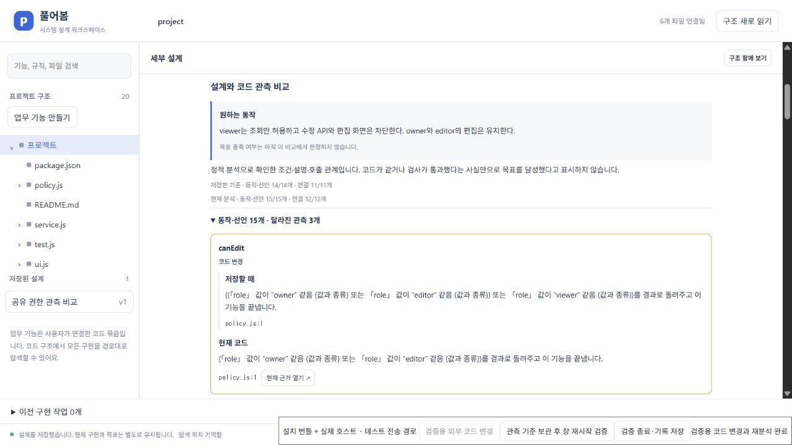
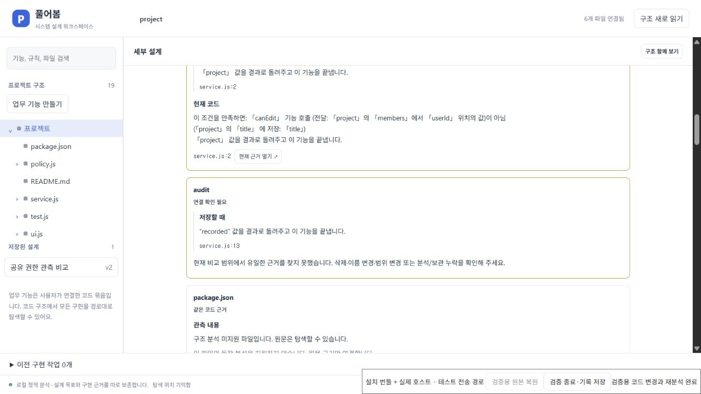

# 저장한 구현과 현재 코드 비교

설계 패널의 **설계와 코드 관측 비교**에서 저장 당시와 현재 분석의 조건·선언·정적 연결을 비교한다. 원하는 동작과 완료 기준은 사용자가 쓴 그대로 유지한다. 이 화면은 자유로운 자연어 요구사항의 충족 여부를 자동 판정하지 않는다.

## 사용 흐름

1. 실제 프로젝트의 기능·파일·함수·규칙을 선택하고 설계를 저장한다. 해당 범위의 코드 관측도 구현 기준에 보관된다.
2. 코드가 바뀌면 재분석한 뒤 **동작·선언** 또는 **호출·모듈·화면 연결**을 펼친다. 바뀐 항목에는 저장할 때와 현재의 설명을 함께 표시한다.
3. **현재 근거 열기**로 현재 분석과 일치하는 실제 코드를 연다. 과거의 줄 번호를 현재 코드 링크로 사용하지 않는다.
4. 완료 기준과 유지 조건은 실제 검사·실행 결과를 따로 검토한다. 이전 검사 통과나 같은 코드 근거만으로 현재 목표 달성을 표시하지 않는다.
5. 새 기준으로 삼기로 결정한 경우 기존의 **기준 코드 비교** 흐름에서 대상을 검토하고 명시적으로 확정한다. 원래 목표와 이전 관측은 보존된다. 문서 저장·재분석만으로 기준을 바꾸거나 에이전트를 시작하지 않는다.

## 표시의 의미

| 표시                       | 확인한 사실                                                                                                 |
| -------------------------- | ----------------------------------------------------------------------------------------------------------- |
| 같은 코드 근거             | 연결된 선언의 정규화된 코드 해시가 같다. 실행 결과나 목표 달성의 증명은 아니다.                             |
| 코드 변경                  | 대응되는 선언의 코드 해시가 달라졌다.                                                                       |
| 같은 내용 · 위치 변경      | 같은 내용의 유일한 선언·규칙을 다른 위치에서 찾았다. 저장한 설계 대상 ID를 자동 변경하지 않는다.            |
| 같은 코드 · 관측 설명 갱신 | 코드 근거는 같지만 분석 설명이나 지원·문법 상태가 달라졌다.                                                 |
| 새로 관측                  | 이전 보관 항목에서 대응되는 근거를 찾지 못한 현재 항목이다. 새 코드가 생겼다는 단정은 아니다.               |
| 연결 확인 필요             | 현재 범위에서 유일한 대응 근거를 찾지 못했다. 삭제·이름 변경·범위 변경·분석 누락·보관 한도를 확인해야 한다. |

정적 연결은 같은 시작·끝 대상과 종류를 묶고, 분석기가 제공하는 소스 위치 수를 표시한다. 호출 위치 두 곳은 실행 횟수 두 번을 뜻하지 않는다. 동적 호출이나 지원하지 않는 프레임워크 연결은 이 비교로 완전성을 보장하지 않는다.

## 보관 범위와 이전 설계

- 관측 하나는 최대 64 KiB, 동작·선언 120개, 연결 120개, 안내 20개다. 긴 설명은 앞 1,000자까지 보관하고 생략 사실을 표시한다. 전체 개수와 표시 개수를 함께 보여준다.
- 전체 설계 문서의 기존 1 MiB 제한과 기준 변경 기록 100개 제한은 유지한다. 한도에 도달하면 저장을 거절하며 기존 목표·기록을 조용히 지우지 않는다.
- 항목별 관측이 없는 이전 설계도 읽을 수 있다. 과거 관측을 현재 코드로 만들어 채우지 않고, 이전 기준 설명과 현재 관측을 구분한다. 명시적으로 기준을 갱신하면 그 시점부터 상세 기록이 생긴다.
- 미지원 파일과 문법 오류는 관측 제한으로 표시한다. 파일 이동은 유일한 동일 근거만 연결하며, 중복 후보를 임의 선택하지 않는다.

## 재현과 증거

관련 단위 검사는 `tests/workspace-observations.test.ts`, 실제 VS Code 호스트 검사는 `extension/test/designWorkspace.ts`에 있다. 설치한 VSIX의 비교 화면과 재시작은 다음 명령으로 수동 검증한다.

```powershell
$env:PUREOBOM_DESIGN_UI = '1'
$env:PUREOBOM_OBSERVATION_UI = '1'
node scripts/test-installed-design-ui.mjs
```

수동 검증은 별도의 일회용 프로젝트에서 설계를 저장하고, 검증용 버튼으로 권한·호출 코드를 변경한다. 설치본 UI에서 전후 비교·원문 이동·기준 확정을 수행한 뒤 호스트를 재시작하고 원본 코드를 복원한다. 호스트는 목표·기준 기록의 유지, 새 프로세스에서의 복원, 원본 파일·Git 상태의 일치와 에이전트 미실행을 확인한다.

검증용 전송 경로와 코드 변경 버튼은 테스트 드라이버에만 있다. 설치된 Production 호스트와 배포 번들 JS/CSS를 브라우저에서 조작하며, VS Code Webview 자체의 네이티브 포인터 전달을 검증한 것은 아니다.

2026-10-20 확인 결과:

| 검증 | 결과와 근거 |
| --- | --- |
| 전체 회귀 | 27개 파일의 검사 227개 통과. [개별 결과와 앞선 실패 기록](evidence/system-workspace/2026-10-20/observations-regression.json) |
| 실제 VS Code 호스트 | 코드 이동·설계 저장·비교·기준 이력을 포함한 33개 확인. [호스트 기록](evidence/system-workspace/2026-10-20/observations-host.json) |
| 최종 VSIX 화면 | UI 요청 13개 성공, 현재 `canEdit` 선언과 `audit()` 호출 원문 선택 확인. [설치본 실행 기록](evidence/system-workspace/2026-10-20/observations-installed-ui.json) |
| 재시작·복원 | 호스트 PID 30112 → 21040. 목표·관측 기준·이전 기준 이력 동일, 원본 8개 파일 해시·HEAD·index·Git 상태 복원, 에이전트 실행 0개·화면 오류 0개. [검증 요약](evidence/system-workspace/2026-10-20/observations-verification.json) |
| 실시간 표시 | 원본 복원 후 재로딩 없이 `audit`의 연결 확인 필요 항목과 현재 관측되지 않은 호출을 표시. [화면 검사](evidence/system-workspace/2026-10-20/observations-rendered.json) |

검증한 VSIX의 SHA-256은 `bac5352723fe0d57802efa9d94ab02a9c4346824b6053d85189e9bf0c72daecc`다. 중간 검증에서 접힌 영역의 항목 순서가 바뀌면 미연결 항목이 재로딩 전까지 보이지 않는 문제를 발견했다. 목록을 유지되는 컨테이너 안에서 갱신하도록 수정한 뒤 새 패키지의 전체 흐름을 다시 검증했다. 단위 검사의 통과만으로 표시 문제까지 해결됐다고 간주하지 않았다.




