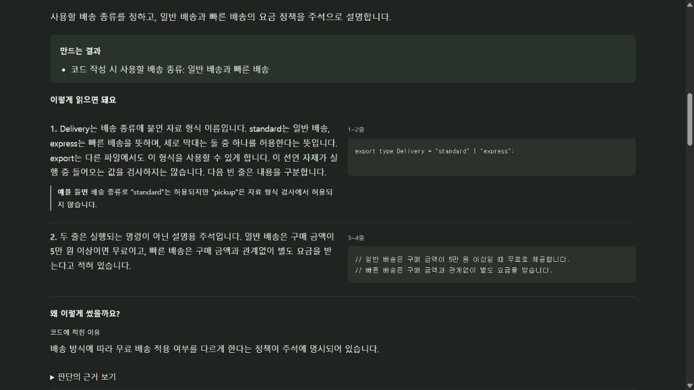
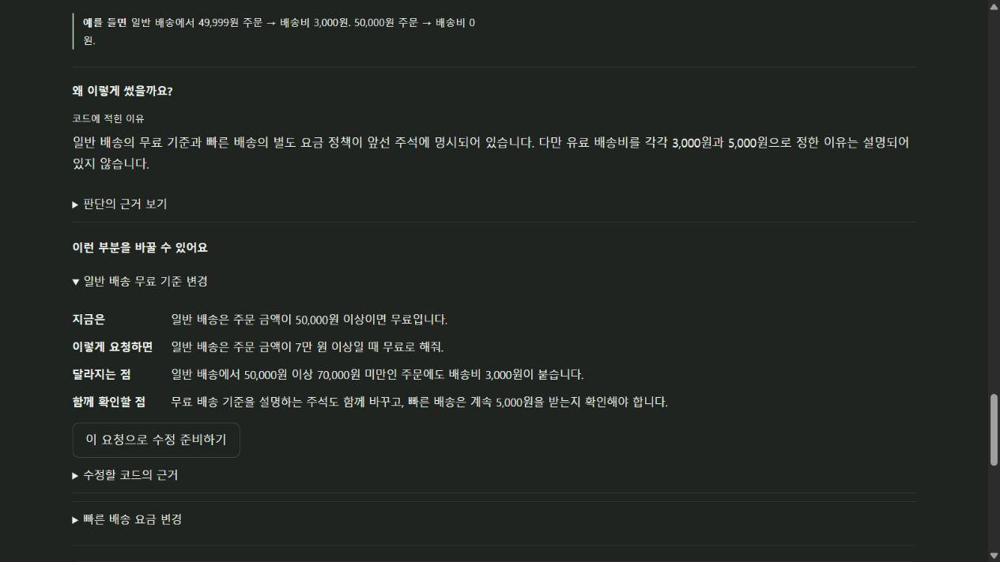

# 파일별 코드 해석과 수정 연결 · 2026-10-20

사용자 요구는 각 파일의 실제 코드를 쉽게 풀어 목적·읽는 순서·수정 방법을 보여주는 것이다. 이 기록은 현재 VS Code 개발판의 검증이며 독립 앱 완료나 비개발자 사용성 검증으로 확대하지 않는다.

## 실제 모델 해석

- [배송비 15줄](shipping-reading.json): 실제 Codex, 세 부분, 약 72.7초. 배송 종류의 타입 선언과 실행 중 검사, 음수·문자열·무한대·0원, 빠른 배송의 조기 반환, 일반 배송 49,999원/50,000원 경계를 원문과 대조했다. 원문을 바꾸지 않았다.
- [문맥 보강 전](context-before.json): 142줄 파일을 두 범위로 나눈 실제 응답. 뒤 범위가 앞부분의 자료 형식 규칙을 “제공되지 않아 알 수 없다”고 설명했다. 줄 연결 검사는 통과했지만 의미 검토는 실패했다.
- [문맥 보강 후](context-after.json): 같은 원문의 전체 문맥을 각 범위와 함께 제공해 다시 생성했다. 약 225.6초, 12부분. 뒤쪽 `validateStories` 설명이 앞부분의 개수·문장 길이·필수 근거·엄격한 항목 검사를 연결했다. 원문 보존과 전체 142줄의 연속 연결도 확인했다. 두 결과를 합쳐 정확도 점수로 만들지 않는다.
- 실제 응답은 저장된 데이터다. 제품의 파일별 설명은 고정된 예문을 반환하지 않으며 현재 원문·모델·프롬프트 버전으로 생성하고 검증된 결과만 캐시한다.

64,000자를 넘는 파일은 파일 시작과 범위 주변의 문맥만 함께 제공한다. 모든 부분의 원문은 읽지만 멀리 떨어진 정의의 의미를 연결하는 데 한계가 있으며 화면에 표시한다. 다른 파일의 구현이나 실제 실행 결과를 이 검사에서 확인한 것으로 표시하지 않는다.

## 화면

실제 `ProjectReader`·`CodeReading` 컴포넌트에 위 실제 배송비 응답을 표시했다. 프로젝트 개요는 작성한 예시이며 전송은 시험용이다. 이 페이지가 실제 수정을 실행한 것은 아니다.

- 파일 선택, 원문 나란히 보기, 수정 예시 펼치기, 편집 가능한 요청 준비와 정확한 파일·원문 해시·줄 범위 전달을 확인했다.
- 원문이 바뀐 상태에서 부분 수정과 구현 버튼이 비활성화되는 것을 확인했다.
- 320px 프레임의 실제 내용 너비 305px에서 가로 넘침이 없었다. 최신 화면의 콘솔 오류는 0건이었다.

## 설치본의 실제 수정

[첫 실행의 실패](installed-before.json): 실제 AI 해석과 코드 변경 후 독립 `test`·`check`가 통과했지만, pnpm이 만든 `.pnpm-store/v11/index.db`를 변경안에 넣으려다 바이너리 검사에서 실패했다. 반영하지 않았으며 원본의 tracked diff와 index diff는 비어 있었다.

수정은 새 `node_modules`·`.pnpm-store` 파일을 원본 복사와 변경안에서 제외한다. 사용자가 이미 추적하던 같은 경로의 파일은 포함하며 잠금 파일도 숨기지 않는다. 에이전트에는 실제 발견한 패키지 관리자와 pnpm 자동 설치를 피하는 실행 설정을 전달한다.

[수정 후 설치본 실행](installed-after.json)은 실제 모델과 production 확장으로 완료했다. 설명의 원문 해시를 바꾼 요청은 구현을 시작하지 못했다. 정상 요청은 배송비 계산과 테스트를 바꾸고 금액 검사 함수·별도 테스트를 추가해 총 네 파일을 변경했다. `test`·`check`가 통과한 뒤 모든 변경 파일의 실제 전후 원문으로 한국어 비교를 생성했다.

검토 기록 없는 반영은 거절됐다. 검토 후 반영한 코드에서 배송비 함수가 새 공통 함수를 호출하는 연결과 별도 동작 검사 9개를 확인했다. 29,999원/30,000원/0원/빠른 배송과 잘못된 금액 다섯 가지를 포함한다. undo 후 기존 두 파일의 바이트, 새 함수·테스트 파일 제거, Git HEAD·index·tracked diff 보존을 확인했다.

설치본 VSIX SHA-256은 `b634a3312f16a03f0e1f77d115fc8f62cc5283206650102c75bfdcfcf41067e5`이다. 설치 후 `extension.cjs`·`agent-host.cjs`·`worker.cjs`·`design.js`도 해당 VSIX의 바이트와 대조했다. 자동화된 설치 호스트 검사이며 사람의 마우스 사용성 관찰로 부르지 않는다.

사용 안내를 갱신해 다시 묶은 최종 VSIX는 `be80420dfcf2f87447c6a7200568c6b150a5e287254b0cbc8336fb62f23a3d7b`이며 위 네 런타임 파일의 해시는 설치 시험본과 같았다. 소스·데모 ZIP과 배포 검사도 통과했다. 첫 배포 검사는 PATH에서 Go를 찾지 못해 중단됐고, 이미 설치된 Go·JDK·.NET SDK 경로를 명시한 재실행에서 패키지 구성·체크섬·라이선스·분석 Worker·Rust·Python·Go·Java·C# 도구 검사가 모두 통과했다.

## 자동 검사와 재현

- 상세 해석·캐시 검사 10개: 줄 누락/겹침, 인용 근거, 원문 개행·Unicode·긴 한 줄, 전체/주변 문맥, 오래된 선택, 재시도·취소·캐시를 확인했다.
- 캐시 제외의 새 회귀 검사는 수정 전 실패를 확인했다. 수정 후 작업 공간 9개가 순차 실행에서 통과해 캐시·tracked 의존성·잠금 파일·반영·undo를 확인했다.
- 관련 여섯 검사 파일을 함께 실행했을 때 36개 중 32개가 통과하고 기존 작업 공간 세 사례가 시간 초과, 종료 검사 한 사례가 fixture 시작 전 시간 초과로 실패했다. 작업 공간 파일은 순차 재실행에서 9개 통과했다. 종료 검사는 자식과 후손 프로세스가 시작됐음을 먼저 확인하도록 고친 뒤 3개 통과했다. 회귀·복구·검사 이력 등 나머지 네 파일은 첫 실행에서 통과했다.
- 웹 빌드, 확장 빌드와 VSIX 패키징이 통과했다. 설치 해시와 완료 여부는 실제 실행별 결과로 구분한다.

`PUREOBOM_RUN_CODEX=1 pnpm reader:live-test`는 새 캐시로 실제 상세 해석을 실행한다. `PUREOBOM_RUN_CODEX=1 pnpm extension:code-reading-live-test`는 별도 프로필과 공개 예제에서 설치본 전체 흐름을 실행한다. PowerShell에서는 먼저 `$env:PUREOBOM_RUN_CODEX='1'`을 설정한다. `pnpm reader:preview`는 저장된 해석 결과를 화면에서 확인하며 실제 구현 전송을 대체한다.

실제 참가자 관찰은 0건이다. 모든 언어·큰 프로젝트·독립 앱·운영체제 조합의 완료를 뜻하지 않는다.
