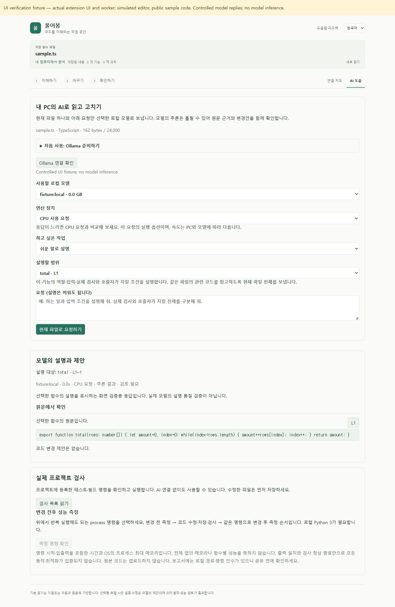
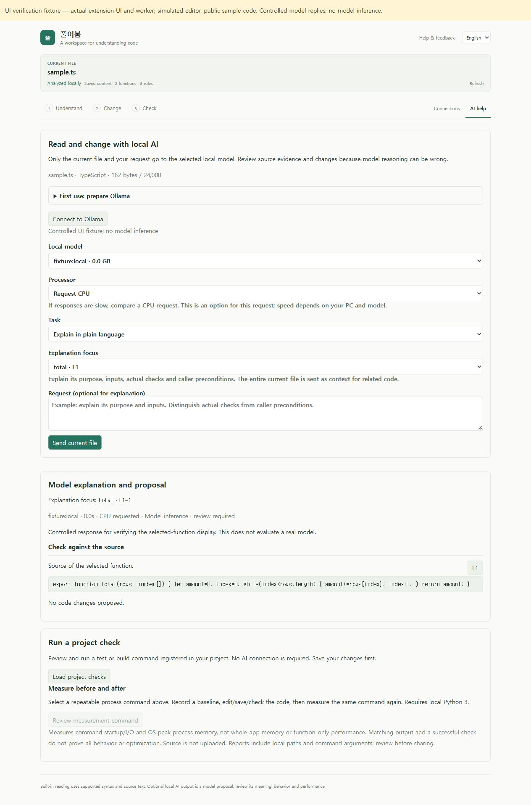

# 함수 원문 구분과 CPU 요청 · 2026-10-20

**0.7 개발 소스. 실제 사용자 프로젝트의 설명 과제는 아직 실패다.** 이전 [180초 시간 초과](focused-explanation.md) 뒤, 같은 변경하지 않은 파일과 같은 질문을 CPU 전용 로컬 서버에서 평가했다. 비공개 파일·함수명·요청·원시 응답·상세 경계 입력은 공개하지 않는다. 아래는 익명화한 사실 기록이다.

## 제품 변경

- 선택 함수 설명은 원문을 `selectedFunction`, `before`, `after`로 구분한다. 선택 함수가 먼저 제시되며, `before + selectedFunction + after`는 원래 파일과 문자 단위로 같다. 주변 코드를 버리거나 요약하지 않는다. 함수 ID와 범위는 확장 호스트가 최신 분석에서 확인한다.
- **연산 장치 / Processor**에서 기본 Ollama 자동 선택 또는 **CPU 사용 요청 / Request CPU**을 고를 수 있다. CPU 요청에만 `options.num_gpu: 0`을 보낸다. 다른 값을 호스트에서 거절하며, 결과에는 실제 하드웨어 측정값이 아닌 요청한 옵션을 표시한다. 설정을 바꾸면 이전 결과를 지운다. CPU가 더 빠르다는 보장은 없다.
- 채팅 요청에 `truncate: false`, `shift: false`를 명시한다. Ollama 0.40.5의 [요청 타입](https://github.com/ollama/ollama/blob/v0.40.5/api/types.go)과 [서버 처리](https://github.com/ollama/ollama/blob/v0.40.5/server/routes.go)를 확인했다. 기존 24KB 파일·2000자 질문·보수적인 문맥 예산·4096 출력 토큰·180초 제한은 유지한다. 다른 서버 버전의 처리나 실제 초과 입력 거절까지 이번에 검증한 것은 아니다.

CPU 선택은 요청 옵션이며 영구 서버 설정을 저장하지 않는다. Ollama의 모델 스케줄링·재로딩에는 영향을 줄 수 있다. 모델 다운로드나 외부 API 전환은 하지 않는다.

## 같은 실제 과제의 세 번의 생성

| 시도                             | 모델             | 응답 시간           | 제품 검증                                 | 의미 검토                                             |
| -------------------------------- | ---------------- | ------------------- | ----------------------------------------- | ----------------------------------------------------- |
| 기존 전체 파일 표현, CPU         | qwen2.5-coder:3b | 서버 총 99.000초    | 선택 함수의 인용이 없어 거절              | 인접 함수를 설명하고 입력 구조를 잘못 해석함          |
| 선택 원문 구분, CPU              | qwen2.5-coder:3b | 클라이언트 81.123초 | 선택 함수의 정확한 인용 4개로 통과        | 실제 입력 결과를 틀리게 설명하고 요청한 조건을 빠뜨림 |
| 선택 원문 구분 + 명시적 CPU 옵션 | qwen3.5:4b       | 서버 총 156.254초   | 원문과 정확히 일치하지 않는 인용으로 거절 | 입력 인덱스·실패 위치·경계 결과에 오류와 누락이 있음  |

**세 번 모두 사용자 설명 과제 성공으로 세지 않는다.** 특히 두 번째 응답은 제품의 인용 검사를 통과했으나 의미 검토에서 실패했다. 이 검사는 인용 위치를 확인하며 설명의 참·거짓을 판정하는 장치가 아니다. 결과를 적용하거나 사용자 원본 파일을 수정하지 않았다. 이전 두 timeout과 앞선 포매터의 기존 테스트 8→8→8 성공은 별도 사실로 보존한다.

의미 검토는 에이전트가 실제 원문과 앞서 기록한 입력별 결과를 대조한 것이다. 독립적인 제3자 평가나 실제 사용자 사용성 실험은 아니다. 평가자가 정한 입력 관찰은 프로젝트가 원래 작성한 테스트와 별도로 보존했다.

서버 시간은 Ollama의 `total_duration`, 클라이언트 시간은 제품이 채팅 요청 전후에 측정한 값이다. [공식 응답 지표](https://docs.ollama.com/api/chat)의 단위에 따라 변환했으며 서로 같은 측정으로 합치지 않는다. 3B 두 응답의 프롬프트/생성 토큰은 각각 1484/332, 1539/544이고, 4B는 1525/717이다. 4B의 `/api/ps`에서 `size_vram: 0`, 문맥 16384를 확인했다.

이전 자동 GPU 실행은 37개 중 4개 레이어만 GPU에 올렸고 다른 작업도 있었다. 이번 CPU 실행은 별도 서버·시점·캐시 상태에서 이루어졌으므로 **CPU 속도 향상률이나 timeout의 단일 원인**을 주장하지 않는다. [Ollama 문맥 안내](https://docs.ollama.com/context-length)에 따라 큰 문맥이 메모리를 더 필요로 한다는 점은 확인했지만 이번 제품 변경에서 문맥 크기를 줄이지 않았다. 평가용 CPU 서버는 확인 후 종료했고 기존 다른 서버를 변경하지 않았다.

## 검증과 재현

핵심 검사 **260개**, 웹/확장 빌드, VS Code 1.96.4의 [개발 55개](focused-context-cpu-development.json)·[production 설치 55개](focused-context-cpu-installed.json)가 통과했다. 설치 VSIX 해시와 실행 파일 11개 해시를 대조했고, 저장소 밖에서 추출한 분석 worker·Rust WASM·Python 측정 및 AST·Go·Java·C# 도구와 패키지 체크섬/manifest/라이선스를 검사했다. [익명 평가·검증 원자료](focused-context-cpu.json). 단위/통합 검사는 제어된 HTTP 응답이며 실제 모델 의미 정확도와 합산하지 않는다. 호스트의 인증 제공자 대기 timeout과 종료 시 N-API 경고는 있었으며 suite 종료 코드는 0이었다.

제품 커밋 `954d6cf76f7bbe29ba72f49bcb1ed49eed160b6d`의 [Windows·Ubuntu Verify](https://github.com/him55710-sudo/pureobom/actions/runs/39308112923)도 양쪽 모두 성공했다. 각 핵심 260개·개발/설치 각 55개·production 모드·실행 파일 11개 해시·추출 도구 실행을 로그에서 확인한 [CI 원자료](focused-context-cpu-ci.json)를 공개한다. 같은 검사를 실행 환경 수만큼 새로운 기능으로 합산하지 않는다. 실제 비공개 모델 생성과 의미 검토는 이 CI에 포함되지 않는다.

`pnpm exec vitest run tests/local-assistant.test.ts tests/ollama.test.ts --maxWorkers=1`의 22개 검사는 원문 조립 보존(Unicode/CRLF 포함), CPU 옵션·잘못된 값 거절·기본 자동 선택과 전송 플래그 등을 포함한다. `extension/test/localAssistant.ts`는 실제 호스트가 같은 값을 전달하고 인용을 원문에서 선택하는지 검사한다.

화면 재현은 확장 빌드 후 `node scripts/preview-function-format.mjs --focus`다. 실제 빌드 UI/worker와 공개 예제를 사용하지만 편집기·모델 답변은 모의 구현이다. 한국어 CPU 선택→생성→결과 표시, 자동 선택 전환→기존 결과 제거, 영어 전환→이전 언어 응답 숨김→새 결과를 확인했다. 설치된 VS Code의 수동 클릭 또는 실제 모델 품질 검증으로 세지 않는다.

