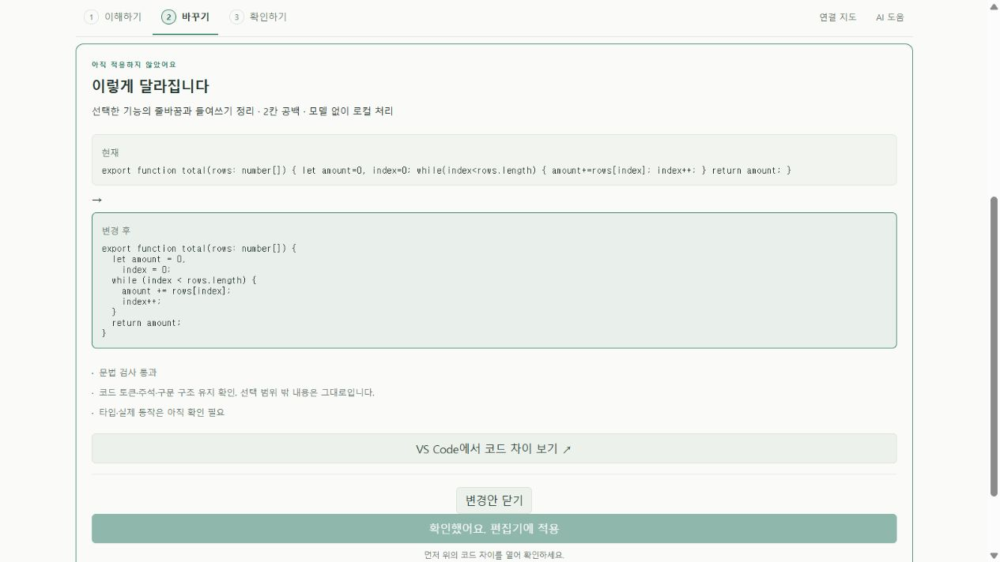
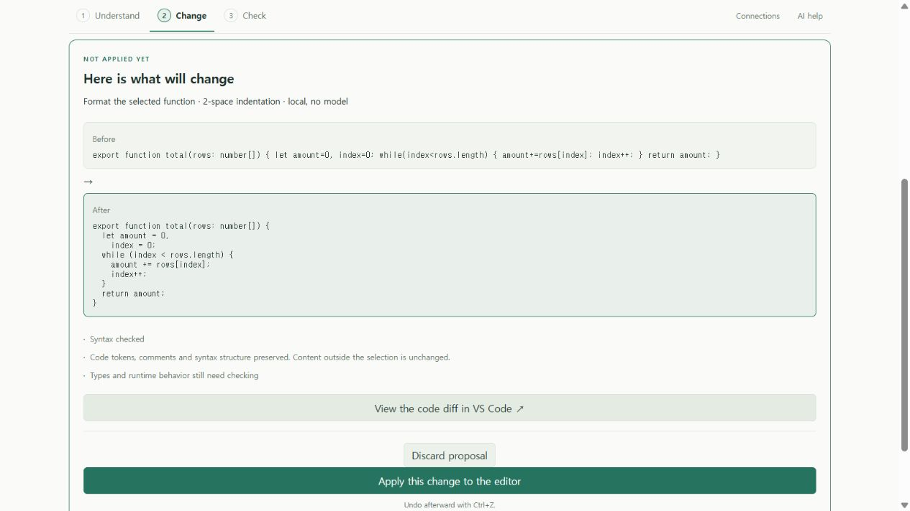

# 모델 없는 함수 서식 정리 · 개발 검증

2026-10-20 KST, Windows의 0.7 개발 소스와 별도 프로필에 설치한 VSIX에서 확인했다. 공개 안정판·웹 데모의 새 기능 배포가 아니다.

## 실제 사용자 프로젝트

사용자가 선택한 비공개 저장소의 고정 버전과 원래 JS 함수를 사용했다. 평가용 오류를 넣지 않았다. 앞선 실제 모델 요청의 실패 기록을 유지하고, 이번에는 **그 요청 중 줄바꿈·들여쓰기 부분만** 로컬 포매터로 수행했다. 함수 설명·입력 전제 생성이나 모델 품질 개선으로 집계하지 않는다.

| 확인 | 결과 |
| --- | --- |
| 원래 프로젝트 테스트, 변경 전 | 8 통과 / 0 실패 / 0 건너뜀 |
| 실제 VS Code source 이동·변경안 생성 | 확인 |
| 미리보기 전 적용 | 호스트가 거절, 원문 유지 |
| 구문·토큰·주석·중괄호·범위 밖 코드 | 보존 확인 |
| native diff 검토 후 명시적 적용 | 편집기만 변경, 자동 저장 없음 |
| 미저장 상태에서 기존 테스트 실행 | 차단 확인 |
| 저장 후 같은 기존 테스트 | 8 통과 / 0 실패 / 0 건너뜀 |
| 같은 서식 재요청 | 변경안 없이 이미 정리됨 안내 |
| native undo·저장 후 같은 기존 테스트 | 8 통과 / 0 실패 / 0 건너뜀 |
| 종료 상태 | 원문 SHA-256 일치, 평가 checkout clean |

검토자는 구현한 Codex이며 독립적인 제3자가 아니다. 소프트웨어 테스트 통과는 해당 프로젝트 도메인 모델의 타당성이나 모든 입력의 동작 보장이 아니다. 성능 개선은 측정하지 않았다. 원래 사용자 작업 폴더와 원격 저장소에는 변경을 반영하지 않았다. 비공개 원문·후보·상세 실행 기록·검토 파일은 로컬에 보존하며 공개 저장소에 싣지 않는다. 따라서 이 익명 요약만으로 외부 독자가 해당 비공개 실행을 독립 재현할 수는 없다.

## 공개 회귀 검사

- 전체 핵심 검사 **242개** 통과, 그중 함수 정리 검사 8개: 촘촘한 코드, 반복 실행, 함수 밖 원문, CRLF, 주석·정규식·템플릿, 자동 세미콜론 삽입, TS/MTS/CTS 메서드, TSX, 잘못된 ID·문법·언어·크기 제한.
- 웹/확장 타입 검사·빌드 통과.
- 실제 Windows VS Code 1.96.4 개발 호스트 **51개 흐름** 통과. 새 함수 정리 흐름은 native diff 필수, 적용·한 번의 undo·무변경 안내·오래된 변경안 거절을 확인한다. 나머지 로컬 AI 사례 중 controlled fixture는 실제 모델 추론으로 세지 않는다. [실행 기록과 소스 해시](function-format-development-integration.json).
- 별도 프로필에 설치한 **0.7.0 VSIX에서도 같은 51개 흐름** 통과. production 모드, 설치 경로, 패키지와 실제 실행 파일 9개의 해시를 대조했다. [설치본 기록](function-format-installed-integration.json). 개발/설치는 같은 흐름을 다른 로딩 방식으로 실행한 것이므로 서로 다른 102개 기능으로 합산하지 않는다. 포함된 C# 검사도 SDK 10.0.402 환경에서 통과했지만 SDK 8/9와 외부 C# 프로젝트 전체 흐름을 추가 검증한 것은 아니다.
- 실제 확장 React UI와 실제 worker를 브라우저에서 조작했다. 한국어/영어 적용 차단, diff 요청 이후 활성화, 적용 후 상태 갱신, 무변경 안내를 확인했다. **편집기 조작은 시뮬레이션**이다. native 동작은 위의 별도 VS Code 기록으로 확인한다. [UI 기록](function-format-ui.json).

## 재현

`pnpm exec vitest run tests/formatFunction.test.ts`, `pnpm extension:build`, `pnpm extension:test`로 공개 검사를 실행한다. 전체 native suite의 Python/Go/Java/C# 검사는 각 문서의 로컬 도구가 필요하다.

같은 설치본 검사는 빌드 후 `pnpm extension:package`, `pnpm extension:test:installed`로 실행한다. 검증한 VSIX SHA-256은 `ed7b0436dac9a49a58fa57dd14e1203126867bbbd5df9c51face73e867b13f38`이다. 이는 로컬 개발 패키지이며 Marketplace 또는 GitHub 안정 릴리스 게시가 아니다.

UI만 확인하려면 `pnpm extension:build` 후 `node scripts/preview-function-format.mjs`를 실행한다. 출력된 임의의 loopback 포트를 브라우저로 연다. **이해하기 → 이 기능의 줄바꿈 정리 → 코드 차이 보기 → 적용** 순서로 조작한다. 재요청하면 무변경 안내가 나온다. 이 서버는 공개 예제만 처리하며 실제 프로젝트 파일을 편집하지 않는다.

첫 화면 검증에서 불완전한 fixture 테마 값으로 대비가 낮았고, 고정 포트가 다른 로컬 앱과 겹쳤다. fixture에 완전한 밝은 테마 값을 넣고 사용 가능한 임의 포트로 변경한 후 위 화면을 다시 확인했다. 다른 앱은 조작하지 않았다. 좁은 화면·모든 테마·새 설치본의 수동 화면 조작·실제 사용자 사용성은 이번 실행 범위 밖이다.
