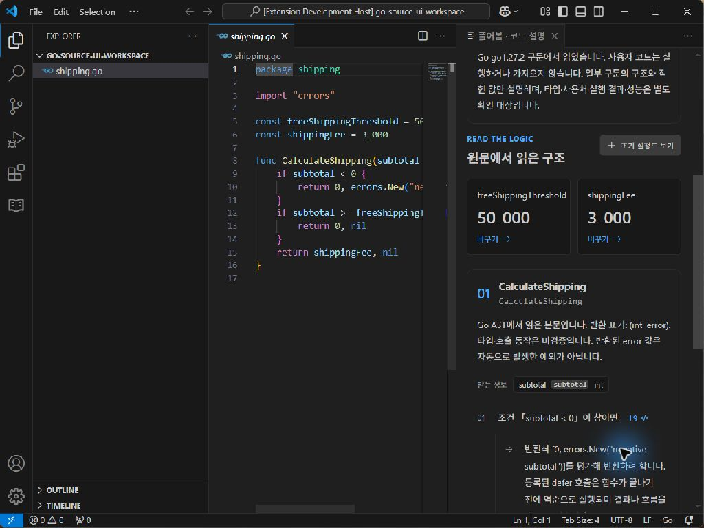
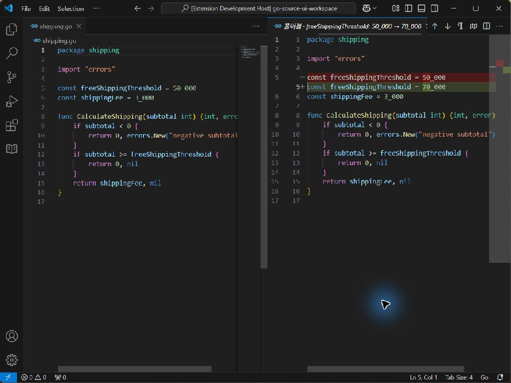
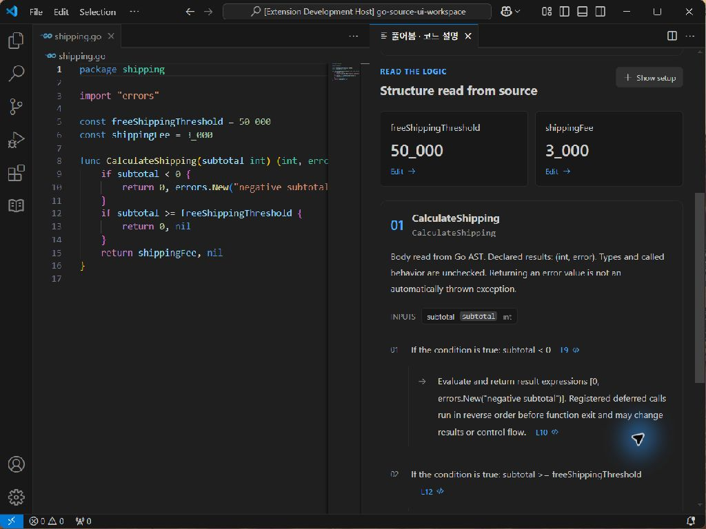

# Go 설치 화면 검증

2026-10-16, Windows · VS Code 1.96.4 · Go 1.27.2. 새 사용자 프로필과 설치된 0.7 개발판으로 공개 [shipping.go](../../../examples/shipping.go) 복사본을 열었다. 테스트 driver 때문에 창 제목에는 Development Host가 붙지만 제품 확장은 별도 설치 폴더에서 production 모드(`ExtensionMode=1`)로 실행됐다.

Computer Use로 실제 UI를 관찰하고 조작했다. 한국어 설명에서 음수 조건·여러 반환식·error 반환과 예외의 차이를 확인했다. 숫자 카드의 **50_000 → 70_000** 변경안을 만들고 native **before.go ↔ after.go** diff에서 정확한 숫자만 바뀐 것을 확인했다. 적용 후 원문과 표가 바뀌고 미저장 표시가 나타났다. 편집기에서 Ctrl+Z로 원문·표·저장 상태가 복구됐다. 영어로 전환해 같은 조건·반환 설명을 확인하고 L9를 눌러 원문 9행으로 이동했다. 모델·Ollama는 사용하지 않았다.

350px 정도의 패널에서는 표를 가로로 스크롤해야 하고 긴 반환 설명이 여러 줄로 늘어난다. 비교 화면은 사이드바를 접어 숫자 전체를 확인했다. 한 번의 버튼 클릭은 화면 밖이어서 `no cached bounds`로 실패했다. 최신 화면을 다시 관찰하고 스크롤/키보드로 버튼을 보이게 한 뒤 진행했다. 이 실패를 성공한 클릭으로 세지 않는다.

화면에 사용한 설치본 host bundle SHA-256은 `2317bb4308a3480713df715c8a7d0499add1a2487a09747d31ddb3a38e43cbd8`이다. 이후 발견한 **이름 없는 AI 문서 diff 확장자 수정**은 이 화면 설치본에 포함되지 않는다. 그 수정 후 [별도 설치 통합 36개](go-source-installed-integration.json)에서 VSIX `239e9ed5c05cbf3ec744e53781d986d84726760d82ef410a6551421c54ec4d11`, production 모드와 7개 런타임 해시를 확인했다. 같은 설치본이라고 혼동하지 않는다.

화면 검증에서 적용 알림이 undo 후에도 남는 것을 발견했다. 후속 UI 수정은 문서 context가 바뀔 때 오래된 알림을 지운다. 이 알림 수정은 위 스크린샷 뒤의 변경이며 최종 CI 설치 검사와 구분한다. 모든 문구의 현지화·접근성·크기 조합을 완전히 검증한 것은 아니다.

디스크의 예제 복사본은 끝까지 원본과 같은 SHA-256 `e284fa508a19aaeab5a125ebbc9a4cf55cd47a9cdce9fa6d0fb9d10cf44d108a`였다. 검증 전용 창은 종료했고 사용자 프로젝트나 프로필은 수정하지 않았다.
