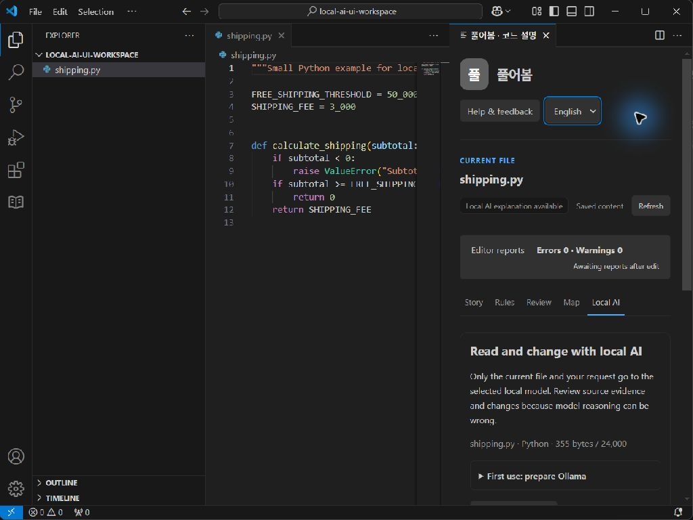

# VSIX 설치본 화면 조작 검증 · 2026-10-16

Windows / VS Code 1.96.4. 개발 호스트와 별개로 빈 사용자·확장 프로필에 0.7.0 VSIX를 CLI로 설치했다. 모델은 Ollama 0.40.5의 `qwen2.5-coder:3b`, 클라우드 비활성화, 루프백 포트 11435다. 테스트 작업 공간에는 공개 `examples/shipping.py`의 복사본만 두었다. 실제 클릭·입력·화면 관찰로 아래 동작을 확인했다.

1. `Pureobom: Explain and edit with local AI` 명령으로 새 설치본 패널을 열었다. 약 350px 패널에서 탭이 줄바꿈되고, Python에 미분석된 함수·규칙 수를 0으로 표시하지 않는 것을 확인했다.
2. **Ollama 연결 확인**을 클릭해 실제 설치 모델 `qwen2.5-coder:3b · 1.9 GB`와 로컬 전용 확인을 받았다.
3. 수정 작업을 선택하고 `무료 배송 기준을 70000으로 바꾸고 나머지 동작은 유지해 주세요.`를 입력했다. 실제 모델 제안은 **17.7초**, 변경 1개, 인용 L3, 로컬 Python 3.12.10 문법 검사 통과였다. 타입·동작·성능은 미검증으로 표시됐다.
4. 적용 버튼이 처음에 비활성화된 것을 확인했다. 전체 diff에서 `FREE_SHIPPING_THRESHOLD = 50_000` → `FREE_SHIPPING_THRESHOLD = 70_000` 외의 변경이 없는 것을 직접 보았다.
5. diff를 닫고 미검증 항목 확인란을 선택한 후 **검토한 변경 적용**을 클릭했다. 실제 소스 값이 `70_000`으로 바뀌고 미저장 표시가 나타났다. 디스크 파일의 SHA-256은 원본 `59725d269c730d3aedaf10f2b8e6f2e3feb99645d2a6e2692bf1b7d62091ebd1` 그대로였다.
6. 소스 편집기를 클릭하고 Ctrl+Z를 한 번 눌렀다. 값이 `50_000`으로 돌아오고 미저장 표시가 사라졌다. 디스크 해시도 원본과 같았다.
7. 설명 언어를 English로 전환해 헤더, 탭, 작업 설명이 영문으로 바뀌고 좁은 패널 안에 배치되는 것을 확인했다. 이는 **UI 언어 전환** 검증이며, 별도의 영어 모델 응답 검증은 아니다.

모델 원문 설명에는 `이 줄은 무료 배송 기준이 50000원으로 변경되었습니다.`라는 부정확한 시제가 있었다. 원본의 기준을 설명하는 위치였으며, 그때 파일은 아직 변경되지 않았다. 인용 위치 일치와 적용 동작 성공을 설명의 완전한 정확성으로 확대하지 않는다.

관찰한 VSIX SHA-256: `e600a908c06dc73d9529f172bf6bd2d43a07ca903aaccee458eaa46b91b6f267`. 관찰 뒤 적용 중 잠깐 표시되던 일반적인 파일 조건 안내를 `현재 파일을 다시 읽는 중`으로 바꾸었다. 이 후속 문구 수정은 빌드로 확인했으며 위 설치본 화면 검증과 구분한다. 이후 묶음의 해시는 포함 문서·소스에 따라 달라진다. 이 검증은 개발판 설치 증거이며 공개 릴리스 완료 선언이 아니다.
