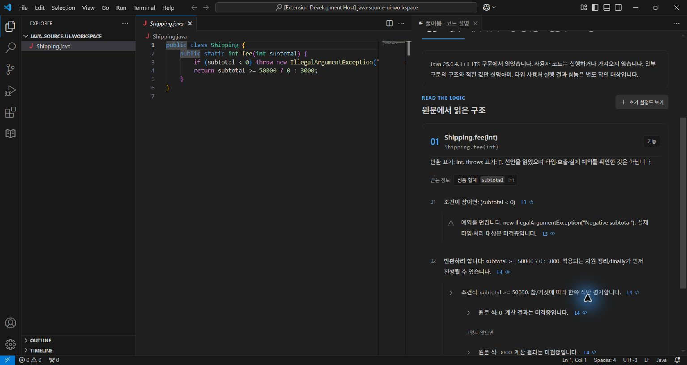
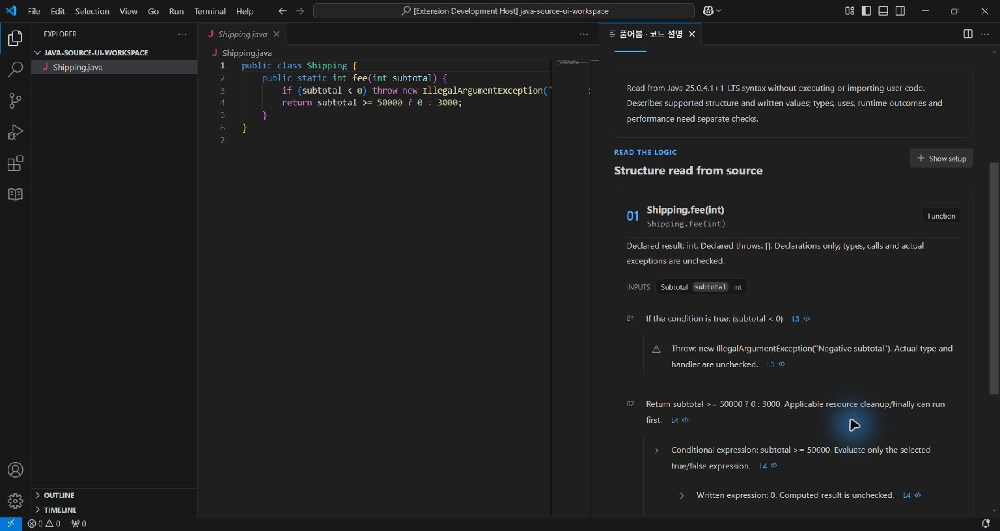
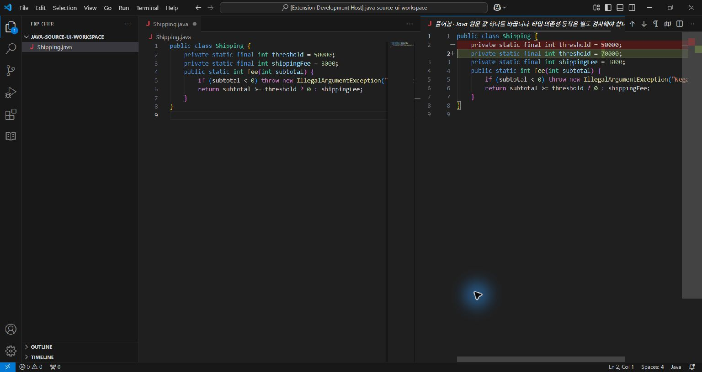
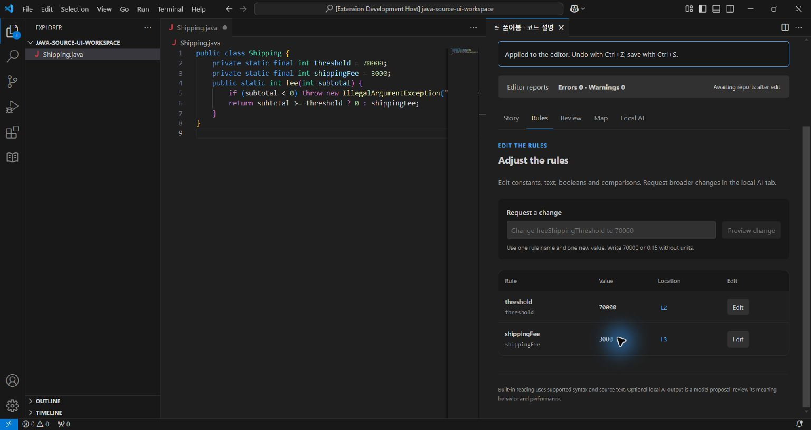
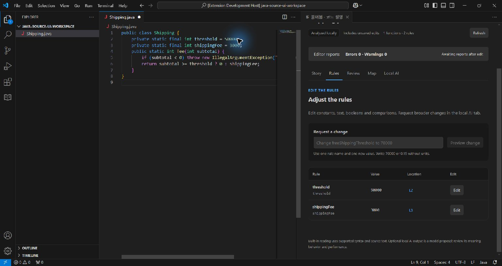

# Java 설치본의 실제 화면과 조작

2026-10-16, Windows/VS Code 1.96.4, Temurin 25.0.4.1+1. [원자료](java-source-native.json)에 설치본 해시·화면 해시·검사 범위를 기록했다. VSIX `bb0aa7ec…`는 [설치 자동 검사](java-source-installed-integration.json)의 동일 설치본이며 확장 실행 모드는 production이다. 창의 Extension Development Host 표시는 별도 test driver 때문이다. 후속 README가 포함된 패키지와는 해시를 구분한다.

한국어와 영어에서 `Shipping.fee(int)`의 음수 예외와 조건식 양쪽을 확인하고, L3를 눌러 원문 3행으로 이동했다. 원래 `examples/local-ai/Shipping.java`는 숫자가 return 식에만 있으므로 직접 수정 규칙이 0개다. 현재 직접 수정은 대입/초기값 리터럴에 한정된다.

직접 수정 조작을 확인하기 위해 검증용 복사본의 편집기 버퍼에 `threshold = 50000`, `shippingFee = 3000` 필드를 추가하고 반환식에서 참조하도록 직접 입력했다. 저장하지 않은 상태에서 2개 규칙으로 재분석됐다. Rules → threshold Edit → 70000 → Preview → Compare in VS Code 순서로 실제 버튼을 눌렀다. 비교 화면에서 정확히 숫자 하나가 바뀌고 원문은 적용 전 50000인 것을 확인했다.

Apply to editor를 누른 뒤 코드와 재분석한 표가 70000이 됐다. 원문 편집기에서 Ctrl+Z로 50000을 복구했고, 한 번 더 undo하여 처음 배송 예제와 깨끗한 버퍼로 돌아갔다. 디스크 파일의 바이트는 원래 예제와 같았다. 이 과정에서 모델·API·Java 사용자 코드 실행은 없었다.

남은 사용성 문제도 있다. 영어 webview에서 열린 native diff 제목에는 한국어가 남는다. 1024×768의 좁은 분할 화면에서는 긴 코드 줄이 가려지고 아래 설명은 스크롤해야 한다. 이번 확인을 전체 반응형/접근성 검증 완료로 세지 않는다. Java language server는 설치하지 않았으므로 편집기 오류 0은 타입 검사를 통과했다는 뜻이 아니다. 실제 외부 코드 검사는 [minimal-json 자료](java-source-project.md)에서 별도로 확인한다.
