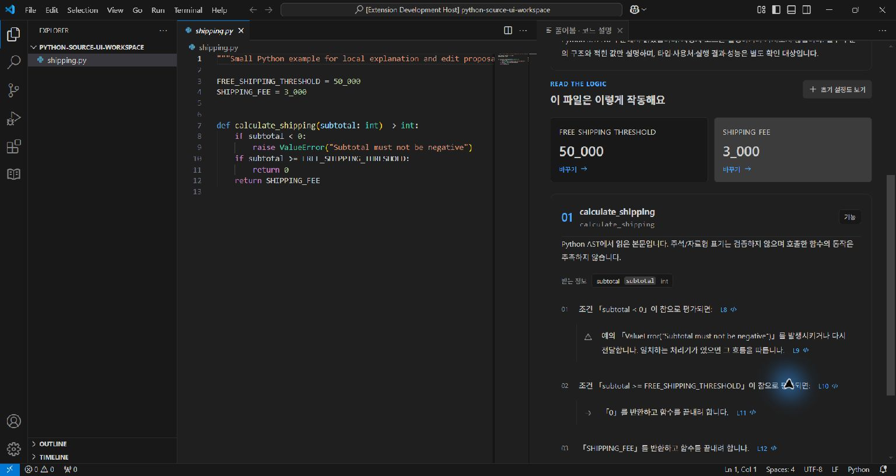
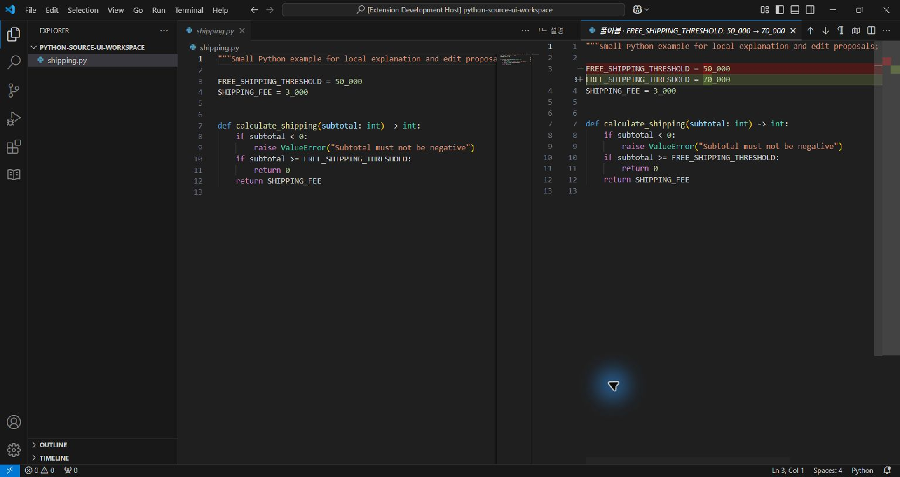
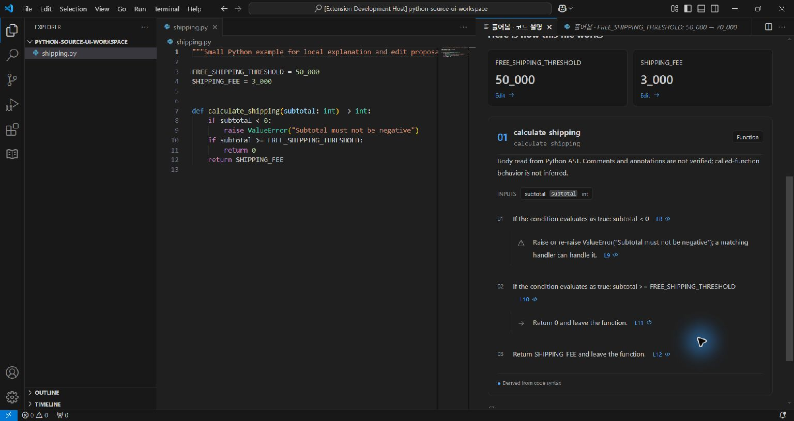

# 설치본 Python 화면 관찰

2026-10-16 18:18–18:22 KST. Windows, VS Code 1.96.4, Python 3.12.10. 설치 VSIX SHA-256 `fd675ef8a7cbd6633ee88a3911b19ccfd6e87784fe57ab05fac41665323b95bb`. 자동 설치 검사에서 production 모드·파일 해시를 확인한 확장 폴더를 사용했다. 새 격리 프로필과 공개 `examples/shipping.py` 복사본에서 시작했고, 별도 test-driver 때문에 창 제목은 Extension Development Host로 표시된다. 제품은 설치한 확장에서 실행했다.

- 약 350px 패널과 최대화한 창에서 Python 버전·부분 분석 안내, `50_000`·`3_000` 원문 표기를 관찰했다.
- 한국어 문장에서 음수 조건, ValueError, `>=` 경계, 0 및 SHIPPING_FEE 반환을 확인했다. 원문 식은 그대로 남으며 원 단위 같은 사업적 의미를 추가하지 않는다.
- 기준 카드 클릭 → 입력 `70_000` → 변경안 생성 → 네이티브 Python diff → 명시적 적용. 편집기는 바뀌었고 규칙 표가 재분석됐다. 별도 디스크 해시는 원본과 같아 자동 저장하지 않았음을 확인했다.
- L3 원문 이동 → Ctrl+Z로 원본 `50_000` 복구. 저장 표시로 돌아왔으며 규칙도 원래 값으로 돌아왔다.
- 영어 선택 → Story에서 조건·예외·두 반환의 영어 문장을 확인했다. 테스트 종료 신호로 새 검증 창만 닫았다. 기존 사용자 창은 닫지 않았다.

검증 중 존재하지 않는 접근성 항목을 사용한 입력 시도는 실패했다. 상태를 다시 읽고 실제 입력란을 선택해 진행했다. 언어 선택기의 set_value도 화면을 바꾸지 않아 선택기 포커스를 확인한 후 키보드 End로 전환했다. 실패한 시도를 제품 기능 성공으로 세지 않는다.

발견한 제품 문구 문제: 하단이 JS/TS 설명만 제공한다고 안내했고 Python의 원문 이름과 맞지 않는 배송 예시, 지원하지 않는 비교 수정 안내가 남아 있었다. 이후 소스에서 Python 안내·요청 placeholder·True/False 표기를 고쳤다. 위 화면은 그 **문구 수정 전 설치본**이다. 최종 설치 해시와 자동 검사 기록은 [별도 파일](python-source-installed-integration.json)로 구분한다. 모든 화면·언어·실패 조합을 검증한 기록은 아니다.
