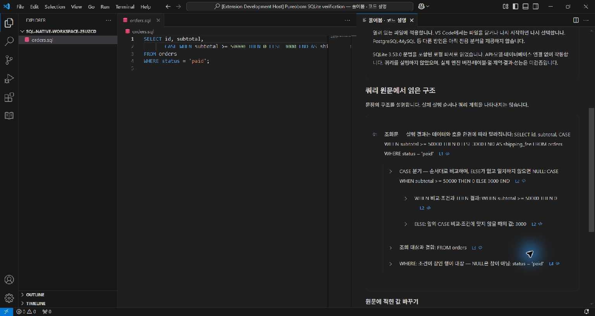
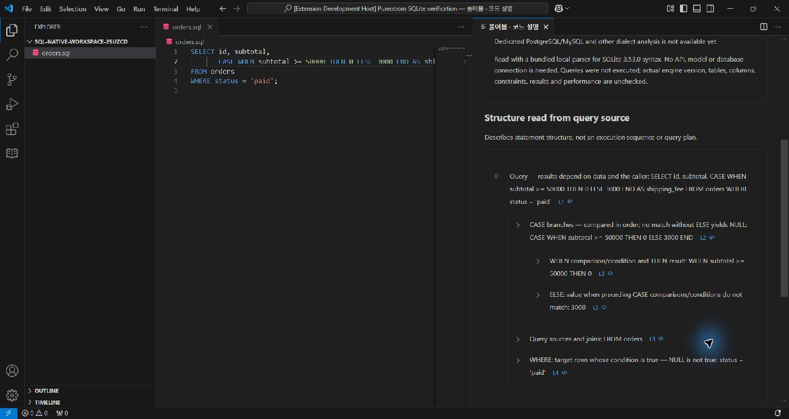
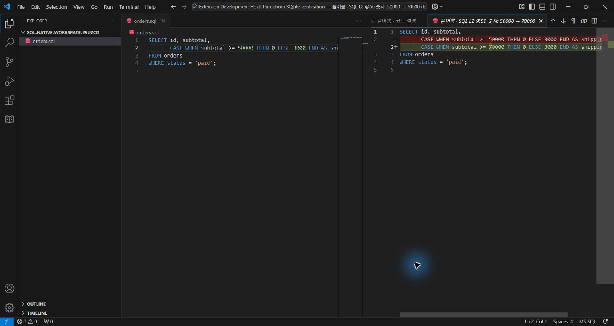
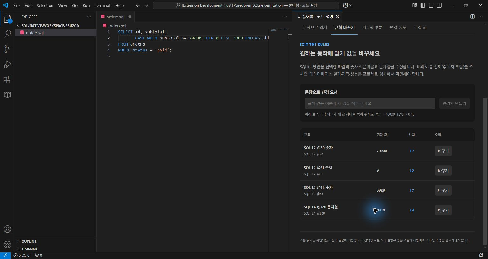

# SQLite 설치본의 실제 화면과 조작

2026-10-17, Windows/VS Code 1.96.4. [원자료](sql-source-native.json)는 설치본 SHA-256, 실행 파일 8개와 화면 해시, 편집기 원상복구를 기록한다. 설치 VSIX `5e907fe1…`의 확장 실행 모드는 production이며 창의 Extension Development Host 표시는 별도 시험 driver 때문이다. 이 화면은 후속 문구·diff 제목 지역화 수정 전이다.

공개 `examples/local-ai/orders.sql`의 별도 복사본을 열었다. 처음에는 방언이 선택되지 않아 규칙이 없었으며 SQLite를 직접 선택하자 숫자 3개와 문자열 1개가 나타났다. CASE/WHEN/ELSE, FROM, WHERE 설명과 문법·실행 결과의 차이를 한국어와 영어에서 확인했다. 한국어 CASE의 L2 링크를 누르면 편집기 2행 1열로 이동했다.

한국어 화면에서 50000 바꾸기 → 새 값 70000 → 변경안 만들기 → VS Code에서 차이 비교를 실제 입력으로 조작했다. 비교에는 숫자 하나의 변경만 있었고 적용 전 원문은 그대로였다. 편집기에 적용한 뒤 원문과 규칙 표가 70000으로 갱신됐다.

원문 편집기에서 Ctrl+Z를 눌러 50000으로 되돌렸다. driver가 기록한 처음/마지막 문서 전체가 같고 버전은 1→3, 최종 dirty는 false였다. 디스크 복사본도 공개 예제와 바이트 단위로 같았다. 저장·모델 요청·DB 연결·SQL 실행은 하지 않았다. 영어는 설명과 수정 안내를 읽었으며 적용·undo 조작은 한국어로 확인했다.

제약과 실패도 기록한다. 화면 밖 접근성 버튼 두 번은 `no cached bounds`로 실패하여 새 화면을 관찰하고 스크롤/좌표로 진행했다. 입력 성공으로 세지 않는다. 최초 1024×768 화면은 설명을 스크롤해야 했고 긴 원문 줄이 가려졌다. 주요 조작과 저장 화면은 1536×816 최대화 상태다. 전체 반응형·키보드·스크린리더 검증은 아니다.

SQL 언어 서버를 설치하지 않았으므로 오류 0은 스키마·쿼리 실행 검증이 아니다. 변경 후 편집기 보고의 갱신 대기 표시가 남았으며 이를 검사 통과로 해석하지 않는다. 한국어의 영어 제목과 영어의 모호한 `full table name` 안내는 후속 수정 대상으로 발견했다. 실제 외부 SQL 결과 검사는 [sqlc 예제](sql-source-project.md), 교차 운영체제 자동 검사는 [별도 CI](sql-source-ci.json)에서 확인한다.

후속 수정은 한국어 Rules 제목과 SQL 규칙 이름 안내를 바로잡고, native diff 설명에 현재 UI 언어를 전달한다. 수정본 VSIX `1cd0c719…`의 [설치 통합 43개](sql-source-localization-installed.json)가 통과했다. [별도 제목 검사](sql-source-localization-titles.json)는 실제 설치본 controller로 한국어/영어 diff를 열고 VS Code 탭 제목을 대조했다. API로 실행한 검사이며 위 수동 클릭 세션을 다시 수행한 것은 아니다. 다른 언어 서버의 진단 대기나 전체 지역화 문제를 해결했다고 주장하지 않는다.

English: Native Korean edit/diff/apply/undo and Korean/English SQLite source reading were checked in an installed production extension. The file was restored exactly. A later installed build passes 43 integration flows and an API-driven check of both native diff titles. This is not a database execution, performance, universal language or complete accessibility claim.
