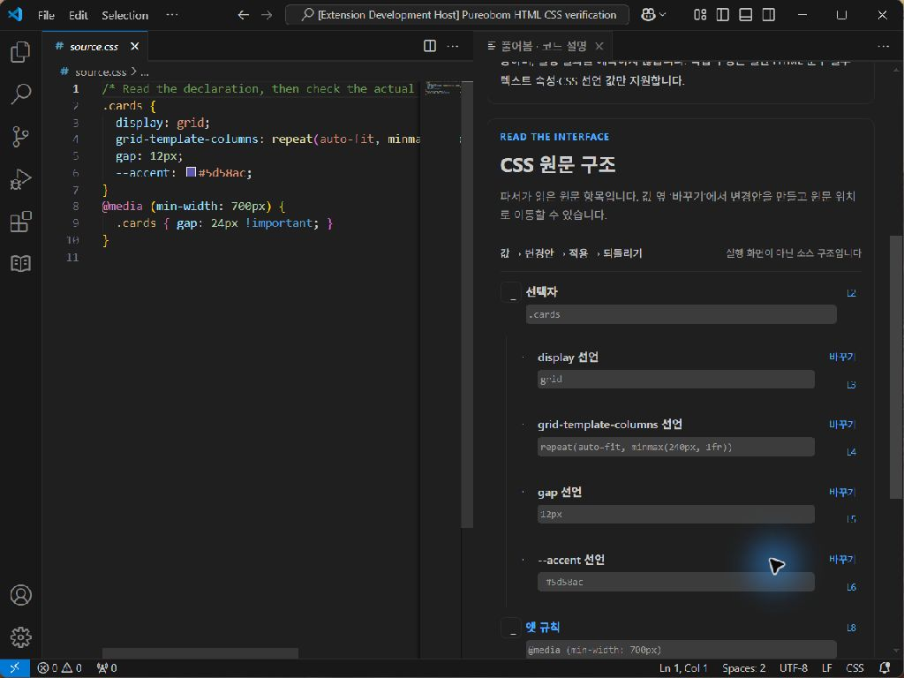
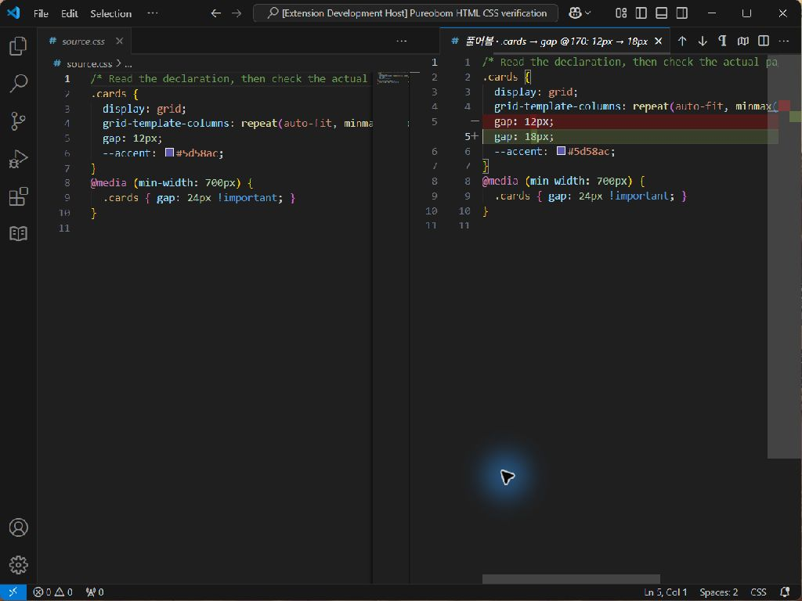
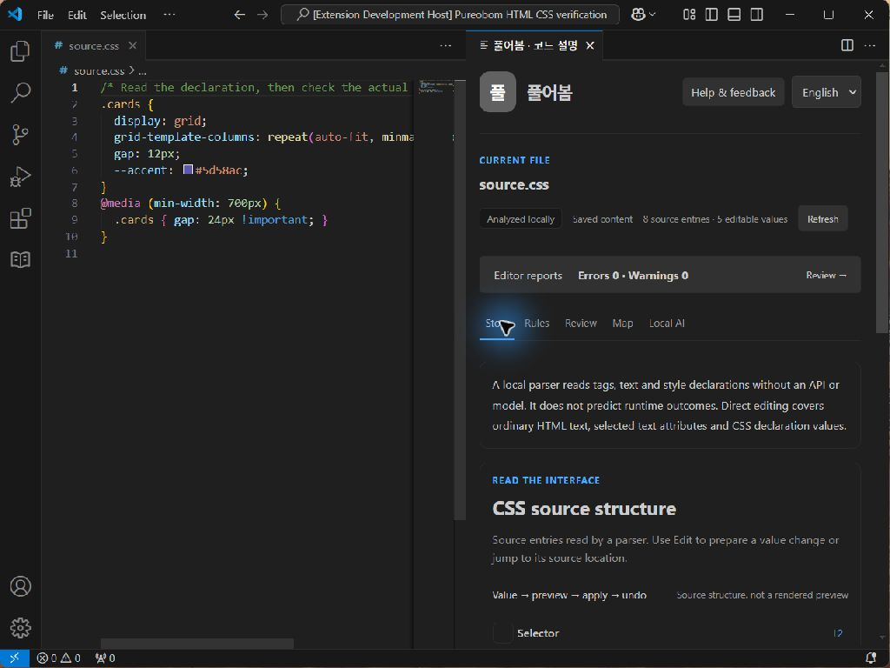
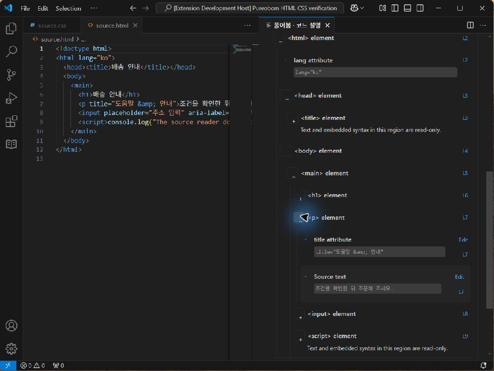

# HTML/CSS 설치 화면 검증

2026-10-16 · Windows · VS Code 1.96.4. 별도 사용자 프로필에 설치한 VSIX `109782f69974a8f9e2354bcb17221b4483d656ae825fcb58101005704be637bf`로 공개 HTML/CSS 예제의 복사본을 열었다. 테스트 driver가 별도로 존재하지만 제품 확장은 설치 폴더의 production 모드(`ExtensionMode=1`)로 실행됐다. [설치 통합 38개](web-source-installed-integration.json)와 같은 패키지다.

Computer Use로 한국어 CSS 트리에서 `.cards`, `repeat(auto-fit, minmax(240px, 1fr))`, `gap`의 원문 값을 확인했다. **12px → 18px** 변경안을 만들고 native CSS diff를 열었다. 미디어 조건의 `24px !important`는 유지됐다. 적용 후 편집기와 표가 18px로 바뀌고 미저장 상태가 표시됐다. Ctrl+Z로 12px와 저장 상태가 복구됐다. 영어로 전환한 뒤 같은 설명과 실제 계산값/스타일 우선순위는 별도 확인한다는 안내를 읽었다.

HTML 예제로 전환해 영어 트리의 html/head/body/main/p 구조, `title="도움말 &amp; 안내"` 속성과 한국어 본문 문구, script 영역의 수정 제외 안내를 확인했다. 이 화면 검증에서 HTML 문구를 직접 적용하지는 않았다. HTML 수정·인코딩·diff·undo는 별도 실제 설치 통합 검사에서 확인했다.

언어 선택 팝업에서 한 번의 클릭은 `Chrome Legacy Window`와 대상 창 경계 불일치로 거절됐다. 창을 다시 활성화하고 현재 선택을 확인한 뒤 Enter로 확정했다. 실패한 클릭을 성공으로 세지 않는다. 일부 액션 직후 접근성 트리/이미지가 이전 상태를 보여 새 관찰 후 계속했다.

약 480px 패널에서는 수정 표를 가로로 스크롤해야 하고 이름이 반복 표시된다. 읽기 트리의 긴 CSS 값은 줄바꿈으로 표시됐다. 모든 창 크기·접근성 조합을 확인한 것은 아니다.

검증 뒤 전용 창은 정상 종료했다. 디스크 복사본과 원본의 SHA-256은 일치했다: CSS `a364a3ba0f7ac67b65aa686b7bcda57592ccf75dda2291c7d8f3120e7603b06d`, HTML `3b6257bcfa7444aa958966255a5b7c2bba22278cfe2a8dcb3f5035b8495b4363`.

이 화면 이후 CSS 문자열 속 주석 기호를 실제 주석과 구분하고, 반복 선언 이름의 위치 표기에 닫는 구분자를 추가했다. 해당 후속 변경의 최종 패키지/CI 검증은 별도 기록하며 이 화면 설치본과 같은 해시라고 주장하지 않는다.
