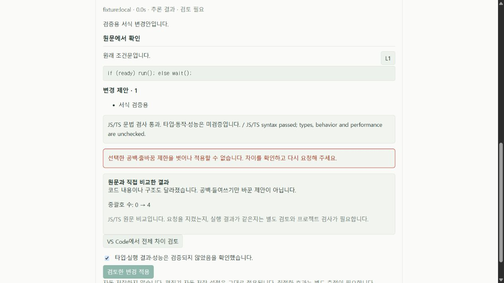
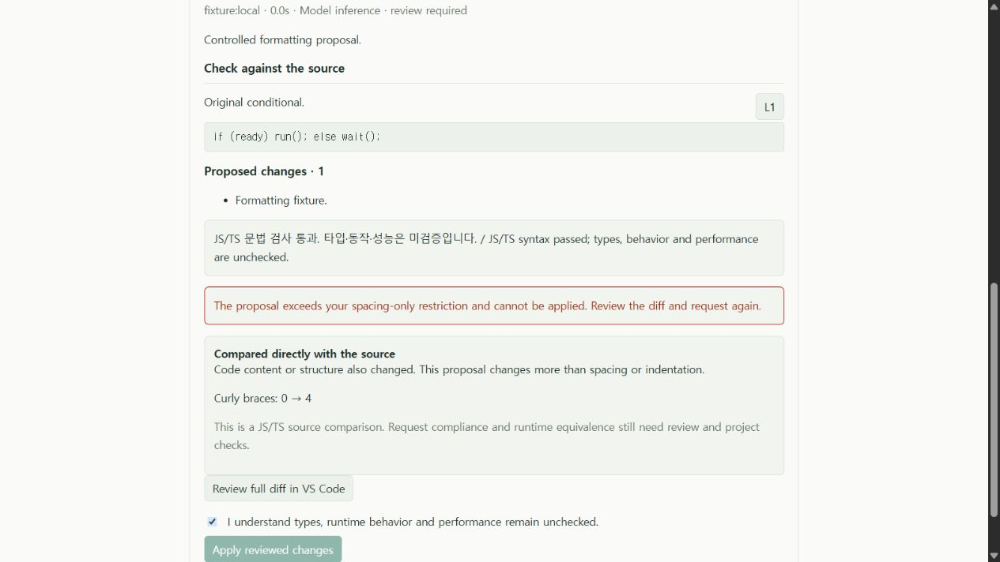
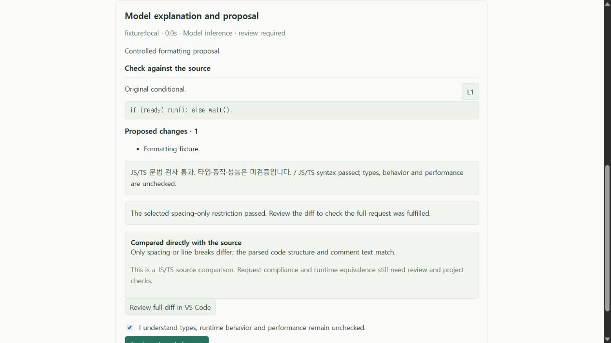

# 명시적 공백·줄바꿈 제한 검증

2026-10-20의 0.7 개발 작업 트리 기록이다. 사용자가 JS/TS/JSX/TSX **수정**에서 제한을 선택하면 코드 토큰·구문 구조·주석 내용/상대 위치가 유지되는지 확인한다. 제한 위반이나 비교 불가인 제안은 native diff를 열어도 적용하지 않는다. 일반 수정과 최적화에는 이 제한을 자동으로 붙이지 않는다.

이 기능은 모델이 좋은 수정안을 생성하게 하는 보장이 아니다. 제한을 통과해도 들여쓰기가 보기 좋거나, 지정한 함수 밖 변경이 없거나, 전체 요청을 충족하거나, 실행 결과가 같다는 뜻은 아니다. 인용·원문 일치·파일 버전·문법 검사와 사람이 하는 diff 검토는 계속 필요하다.

## 근거 구분

| 근거 | 확인한 결과 | 범위 |
| --- | --- | --- |
| 핵심 검사 | 전체 234개 통과 | 언어/작업/제한 입력, 공백 변경, 문자열·주석 이동·ASI·구조 변경, 비교 불가 판정 등. 실제 모델 정확도 수치 아님 |
| [실제 편집기 통합](whitespace-constraint-development-integration.json) | 49개 흐름 통과 | Windows / VS Code 1.96.4 개발 호스트. 모델 HTTP 응답은 fixture |
| [실제 React 화면 조작](whitespace-constraint-ui.json) | KO/EN 차단, 허용된 제안 검토 후 활성화, 작업 전환 시 제한 제거 | 브라우저 harness. 모델·편집기 동작은 모의 구현, 원문 비교는 실제 제품 worker |
| 실제 사용자 프로젝트 | 같은 요청에 모델이 여전히 요청 밖 변경을 생성. 새 호스트 제한이 적용을 거절 | 비공개 소스·응답·전체 보고서는 로컬 보관. 성공한 유지보수 수정으로 집계하지 않음 |

핵심 검사, 편집기 흐름, 모델 실행, 사용자 프로젝트 기존 테스트 개수를 하나의 성공률로 합치지 않는다. 개발 작업 트리의 소스·번들 해시는 각 JSON의 `source.sha256`에 있다. 새 설치 VSIX, 사용자 연구, 모든 테마·화면 크기 인증은 아니다.

## 실제 편집기에서 확인한 경로

`extension/test/localAssistant.ts`의 controlled HTTP 응답을 실제 `LocalAssistantController`와 worker, VS Code 문서·diff·편집 API에 연결했다.

1. 문법은 맞지만 if/else 중괄호를 추가하는 제안: 일반 수정에서는 비교 사실만 표시한다.
2. 같은 제안에 사용자가 공백·줄바꿈 제한을 선택: `constraint.status = failed`. native diff를 열고 미검증 확인을 해도 호스트 `apply`가 거절하며 원문이 같다.
3. 코드 토큰과 구조를 유지하는 실제 줄바꿈 제안: `constraint.status = passed`. native diff → 명시적 적용 → editor undo로 정확한 원문 복구를 확인했다.
4. 문법 오류로 비교할 수 없는 제안: `constraint.status = unavailable`, 기존 문법 오류 적용 차단도 유지한다.

원래 Python/Go/Java/C#/SQL·프로젝트 검사·성능 측정 흐름은 같은 통합 실행에서 회귀 확인했다. 여기서 허용된 서식 변경은 fixture이며 사용자 프로젝트의 실패를 대체하지 않는다.

## 화면과 재현

제품의 실제 `LocalAssistant.tsx`를 사용했다. 처음 harness에서 밝은 전경과 어두운 기본 surface가 섞였으므로 누락된 테마 변수를 추가했다. 이는 테스트 환경 수정이며 제품 색상 수정 성과가 아니다. 자동 입력 중 IME 잔여 문자와 label 선택기 실패가 있어, DOM에서 확인한 textbox 역할로 정확한 최종 입력을 넣었다. 실제 전송 요청 목록도 UI JSON에 보존했다.

한국어에서 제한을 벗어난 제안을 검토하고 미검증 확인란을 선택해도 적용 버튼은 비활성이다.



영어에서도 같은 제한과 차단이 표시된다.



제한을 지킨 제안은 전체 요청을 별도로 검토하라고 안내하며, diff 검토·확인 후 적용 버튼이 활성화된다. 실제 native 적용과 undo 근거는 위 편집기 통합 기록이다.



모든 이미지는 원본 JPEG다. 실제 비공개 프로젝트나 모델 응답을 화면에 넣지 않았다.

```sh
pnpm install --frozen-lockfile
pnpm test --maxWorkers=2
pnpm build
pnpm extension:build
pnpm extension:test
node scripts/preview-local-assistant.mjs
```

언어별 SDK 준비는 [지원 표](../../LANGUAGE_SUPPORT.md)의 해당 언어 문서를 따른다. SDK가 없어서 건너뛴 검사를 이 기록의 전체 통과와 동등하게 해석하지 않는다.

마지막 명령은 `http://127.0.0.1:4187`에 **검증용 화면**을 연다. Ollama나 사용자 소스는 사용하지 않는다. 연결 → 수정 작업 → 제한 선택 후 일반 텍스트를 요청하면 중괄호를 추가한 fixture가 나온다. `valid whitespace`를 요청하면 공백만 바꾼 fixture가 나온다. 이는 harness의 사례 선택 문구이며 제품의 특수 명령이 아니다. 한국어/영어와 다른 작업으로 바꾸며 상태를 확인할 수 있다. harness 로그는 ignored `test-results/constraint-ui/`에 기록한다.
